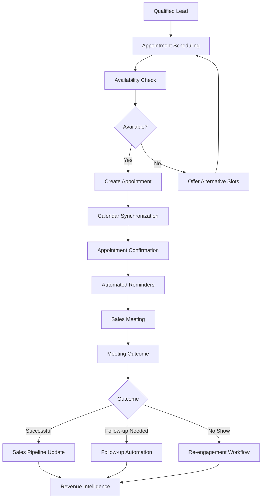
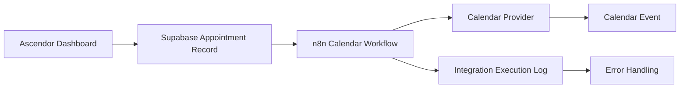
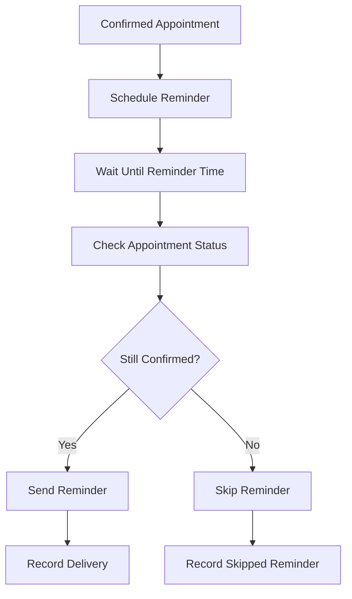

# Ascendor Flagship 01 — Appointment & Sales Handoff

## 1. Document Overview

**Project:** Ascendor AI Lead Generation & Revenue Engine  
**Module:** Appointment & Sales Handoff  
**Version:** 1.0  
**Status:** Architecture Specification  
**Architecture Standard:** Reliable, Scalable, Premium, Simple & Usable

This document defines the appointment scheduling and sales handoff architecture of Ascendor Flagship 01.

The module transforms qualified leads into organized sales conversations by coordinating appointment scheduling, availability management, calendar synchronization, confirmations, reminders, salesperson assignments, and post-meeting follow-up.

The system must ensure that every qualified opportunity can move toward a sales conversation without unnecessary manual coordination.

---

## 2. Business Objective

The primary objective of Appointment & Sales Handoff is to convert qualified leads into scheduled sales opportunities.

The system must:

- Enable qualified leads to book appointments.
- Allow sales representatives to manage their availability.
- Prevent scheduling conflicts and double bookings.
- Automatically send appointment confirmations.
- Deliver timely appointment reminders.
- Support rescheduling and cancellation.
- Assign qualified opportunities to the appropriate sales representative.
- Provide sales representatives with relevant lead information.
- Record meeting outcomes.
- Trigger appropriate post-meeting follow-up.
- Maintain appointment history and activity records.
- Support multiple users and organization-specific calendars.

### Business Outcome

Ascendor should reduce scheduling friction, improve sales response consistency, and help businesses convert qualified opportunities into actual sales conversations.

---

## 3. Architectural Position

The Appointment & Sales Handoff module operates as part of Ascendor's unified automation architecture.

### System Components

| Component | Responsibility |
|---|---|
| Next.js Dashboard | Appointment management and sales visibility |
| Supabase | Appointment records, organization data, and authorization |
| n8n | Scheduling-related automation, confirmations, reminders, and follow-up |
| Calendar Provider | External calendar synchronization |
| Email Provider | Appointment notifications and reminders |
| Sales Representative | Meeting execution and outcome recording |

---

## 4. Appointment Lifecycle

Every appointment must follow a controlled lifecycle.

### Appointment Statuses

| Status | Description |
|---|---|
| REQUESTED | Appointment request has been submitted |
| PENDING_CONFIRMATION | Appointment requires confirmation |
| CONFIRMED | Appointment is successfully scheduled |
| COMPLETED | Meeting has taken place |
| CANCELLED | Appointment has been cancelled |
| NO_SHOW | Lead did not attend the meeting |

### Rescheduling

Rescheduling should preserve the original appointment history.

The system should:

1. Identify the existing appointment.
2. Validate the requested new time.
3. Check availability.
4. Update the appointment schedule.
5. Synchronize the calendar event.
6. Cancel obsolete reminders.
7. Schedule new reminders.
8. Notify relevant participants.
9. Record the rescheduling event.

The appointment should remain logically the same appointment unless a business rule requires a separate appointment record.

---

## 5. Appointment Scheduling

Ascendor must support three scheduling methods.

### 5.1 Self-Service Scheduling

Qualified leads receive a booking link.

The lead can:

- View available appointment slots.
- Select a preferred date and time.
- Select an available meeting type.
- Submit appointment details.
- Receive confirmation after successful booking.

### 5.2 Assisted Scheduling

A sales representative or authorized organization member schedules an appointment on behalf of a lead.

The representative can:

- Select the lead.
- Choose an available time.
- Assign a sales representative.
- Select the meeting type.
- Create the appointment.
- Send confirmation to the lead.

### 5.3 Sales Representative Scheduling

Sales representatives can schedule appointments directly through the dashboard.

The system must validate:

- Organization ownership.
- Sales representative membership.
- Calendar availability.
- Appointment duration.
- Scheduling rules.
- Required lead information.

---

## 6. Availability Management

Availability management determines when appointments can be scheduled.

### Availability Configuration

Organizations should be able to configure:

- Business operating hours.
- Sales representative working hours.
- Available weekdays.
- Appointment duration.
- Buffer time between meetings.
- Minimum booking notice.
- Maximum advance booking period.
- Holidays and unavailable dates.
- Meeting types.
- Time zone.
- Maximum appointments per day.

### Availability Rules

The system must:

- Prevent overlapping appointments for the same sales representative.
- Respect existing calendar events.
- Respect organization scheduling rules.
- Prevent appointments outside permitted availability.
- Account for appointment duration and buffer time.
- Display available times in the lead's appropriate time zone.
- Store appointment timestamps consistently.
- Revalidate availability immediately before booking.

### Double-Booking Protection

Availability displayed to the user is not sufficient to guarantee a booking.

Ascendor must perform a final availability check during appointment creation.

The booking process must prevent concurrent requests from creating conflicting appointments.

Where necessary, use database transactions, locking, or equivalent conflict-prevention mechanisms.

---

## 7. Calendar Integration

Ascendor should support external calendar synchronization.

### Initial Integration Direction

- Google Calendar
- Microsoft Outlook Calendar

Additional calendar providers may be supported in future versions.

### Calendar Capabilities

The integration should support:

- Creating calendar events.
- Updating calendar events.
- Cancelling calendar events.
- Checking calendar availability.
- Synchronizing appointment times.
- Attaching meeting details.
- Recording external calendar event identifiers.

### Calendar Integration Rules

- Each organization must connect its own calendar accounts.
- Calendar credentials must remain securely stored.
- Calendar access must be authorized.
- Calendar events must be associated with the correct organization.
- External calendar changes should be reconciled where supported.
- Failed calendar synchronization must not silently disappear.
- Duplicate calendar events must be prevented.
- Calendar disconnection must not expose another organization's events.

### Integration Architecture

The database appointment record should remain the internal source of truth for Ascendor appointment management.

External calendar synchronization must be handled as a separate integration process.

---

## 8. Appointment Creation Workflow

The appointment creation workflow must follow a controlled sequence.

### Workflow

1. Receive appointment request.
2. Validate request data.
3. Verify organization membership and permissions.
4. Verify lead ownership within the organization.
5. Verify assigned sales representative.
6. Validate appointment duration and meeting type.
7. Check availability.
8. Apply scheduling rules.
9. Create appointment record.
10. Synchronize external calendar if connected.
11. Generate confirmation details.
12. Send appointment confirmation.
13. Schedule appointment reminders.
14. Record workflow execution.
15. Display appointment in the dashboard.

### Failure Handling

If calendar synchronization fails:

- Preserve the internal appointment record when appropriate.
- Mark calendar synchronization as failed or pending.
- Record the integration error.
- Retry according to the configured retry policy.
- Notify an authorized organization member if manual intervention is required.

The system must distinguish between:

- Appointment successfully created internally.
- Appointment successfully synchronized externally.
- Appointment confirmation successfully delivered.

These are separate outcomes and must not be represented as one misleading success state.

---

## 9. Appointment Confirmation

After successful appointment creation, Ascendor should automatically send confirmation.

### Confirmation Channels

Initial channels:

- Email

Future channels:

- SMS
- WhatsApp
- Other supported messaging integrations

### Confirmation Information

The confirmation should contain:

- Lead name.
- Organization or business name.
- Appointment date.
- Appointment time.
- Time zone.
- Meeting duration.
- Meeting type.
- Sales representative.
- Meeting location or meeting link.
- Rescheduling instructions.
- Cancellation instructions.

### Confirmation Rules

- Confirmation must only be sent after the appointment is successfully created.
- Appointment times must be displayed in the appropriate time zone.
- Failed delivery must be logged.
- Confirmation retries must not create duplicate appointments.
- The dashboard must distinguish appointment creation from notification delivery.

---

## 10. Automated Appointment Reminders

Ascendor should automatically remind participants before scheduled meetings.

### Default Reminder Schedule

Recommended initial configuration:

- 24 hours before the appointment.
- 1 hour before the appointment.

Organizations may customize reminder schedules.

### Reminder Requirements

The reminder system must:

- Use the appointment's current scheduled time.
- Respect the appointment time zone.
- Stop reminders for cancelled appointments.
- Replace obsolete reminders after rescheduling.
- Avoid duplicate reminder delivery.
- Record delivery attempts.
- Handle provider failures.
- Support organization-specific reminder settings.

### Reminder Workflow

A reminder must never be sent based solely on an outdated scheduling event.

Before delivery, the system must verify that the appointment is still confirmed and the reminder is still valid.

---

## 11. Rescheduling and Cancellation

Leads and authorized organization members must be able to reschedule or cancel appointments according to business rules.

### Rescheduling

The system must:

- Validate the requesting user's permission.
- Verify the appointment belongs to the correct organization.
- Check availability for the new time.
- Update the internal appointment record.
- Synchronize the calendar event.
- Update reminder schedules.
- Notify participants.
- Preserve the previous appointment details in history.

### Cancellation

The system must:

- Validate cancellation permissions.
- Record the cancellation reason when available.
- Update appointment status.
- Cancel future reminders.
- Synchronize cancellation with the calendar provider.
- Notify relevant participants.
- Record the cancellation event.

### Cancellation Policy

Organizations may configure:

- Cancellation deadlines.
- Rescheduling deadlines.
- Required cancellation reasons.
- Whether sales representatives may cancel directly.
- Whether approval is required for certain appointment changes.

Sensitive or business-critical scheduling actions may require human approval.

---

## 12. Sales Representative Assignment

Ascendor must support assignment of appointments to appropriate sales representatives.

### Assignment Methods

- Manual assignment.
- Organization-defined default representative.
- Round-robin assignment.
- Assignment based on availability.
- Assignment based on lead ownership.
- Assignment based on sales team or territory.

Advanced assignment rules may be introduced in future versions.

### Assignment Requirements

The system must:

- Assign only valid organization members.
- Prevent assignment to users outside the organization.
- Respect sales representative availability.
- Preserve assignment history.
- Notify the assigned representative.
- Update the lead's ownership when appropriate.
- Support reassignment by authorized organization members.

### Assignment Priority

Recommended initial priority:

1. Existing lead owner.
2. Explicitly selected sales representative.
3. Organization default representative.
4. Eligible available representative.

If no eligible representative exists, the appointment must not be silently assigned to an arbitrary user.

---

## 13. Sales Handoff

Sales handoff ensures the assigned representative receives the information required to conduct a productive meeting.

### Sales Handoff Information

The sales representative should receive:

- Lead identity and contact information.
- Company information.
- Lead source.
- Qualification status.
- Lead score.
- Budget information when available.
- Intent and urgency.
- Customer requirements.
- AI qualification summary.
- Previous interactions.
- Appointment details.
- Relevant conversation history.
- Recommended sales next steps.

### Handoff Actions

After an appointment is confirmed:

1. Update the lead's pipeline stage.
2. Assign or confirm the lead owner.
3. Notify the assigned representative.
4. Provide lead context.
5. Display appointment details.
6. Record the handoff activity.

### Sales Handoff Principle

A sales representative should not need to search multiple systems to understand why a lead booked a meeting.

Ascendor should provide the relevant context in one organized interface.

---

## 14. Meeting Outcomes

After the appointment, the sales representative should record the meeting outcome.

### Outcome Options

- Successful sales conversation.
- Qualified opportunity.
- Proposal requested.
- Follow-up required.
- Not interested.
- Not qualified.
- No show.
- Rescheduled.

### Meeting Outcome Information

The system should support:

- Meeting notes.
- Outcome classification.
- Customer objections.
- Customer requirements.
- Next action.
- Follow-up date.
- Updated lead status.
- Updated pipeline stage.
- Estimated opportunity value.

### Meeting Completion Workflow

1. Sales representative opens appointment.
2. Records meeting outcome.
3. Adds meeting notes.
4. Identifies next action.
5. Updates lead status or pipeline stage.
6. Saves the meeting outcome.
7. Triggers the appropriate follow-up automation.
8. Records the activity in the lead history.

Meeting outcomes must remain associated with the correct organization and lead.

---

## 15. Post-Meeting Follow-Up

Ascendor should automatically initiate appropriate follow-up after a meeting.

### Possible Follow-Up Actions

- Send thank-you email.
- Send requested information.
- Deliver proposal or quotation.
- Schedule another appointment.
- Create follow-up reminder.
- Initiate a nurturing sequence.
- Notify sales management.
- Update pipeline reporting.

### Follow-Up Rules

- Follow-up must depend on the recorded meeting outcome.
- The system must not send irrelevant messages.
- Sensitive communications may require human approval.
- Sales representatives must be able to review or override follow-up actions.
- Follow-up activities must be logged.
- Duplicate follow-up execution must be prevented.

---

## 16. Multi-User and Organization-Specific Scheduling

Ascendor must support multiple users within the same organization.

### Organization Capabilities

Each organization may have:

- Multiple sales representatives.
- Multiple connected calendars.
- Multiple appointment types.
- Organization-specific working hours.
- Organization-specific reminder settings.
- Organization-specific scheduling policies.
- Multiple appointment booking links.
- Organization-specific notification rules.

### Multi-Tenant Requirements

- Every appointment belongs to one organization.
- Every lead belongs to the same organization as its appointment.
- Assigned sales representatives must belong to that organization.
- Calendar integrations must be organization-scoped.
- Organization users must not access appointments from other organizations.
- Appointment workflows must preserve organization context.
- Background automation must not bypass tenant authorization.

---

## 17. Appointment Data Model

The appointment module builds upon the appointments table defined in the database design.

### Core Appointment Fields

| Field | Purpose |
|---|---|
| id | Unique appointment identifier |
| organization_id | Organization ownership |
| lead_id | Associated lead |
| title | Appointment title |
| scheduled_at | Appointment start timestamp |
| duration_minutes | Appointment duration |
| status | Appointment lifecycle status |
| assigned_to | Assigned sales representative |
| created_at | Creation timestamp |
| updated_at | Last update timestamp |

### Recommended Future Fields

The following fields may be introduced through schema migrations:

| Field | Purpose |
|---|---|
| timezone | Appointment display and scheduling time zone |
| meeting_type | Online, phone, or in-person |
| meeting_url | Online meeting link |
| location | Physical meeting location |
| calendar_provider | Connected calendar provider |
| calendar_event_id | External calendar event identifier |
| created_by | User who created the appointment |
| cancellation_reason | Reason for cancellation |
| confirmed_at | Confirmation timestamp |
| completed_at | Meeting completion timestamp |

### Appointment Event History

An appointment event history should preserve important changes.

Examples:

- Appointment created.
- Appointment confirmed.
- Appointment rescheduled.
- Appointment cancelled.
- Sales representative assigned.
- Meeting completed.
- Meeting outcome recorded.

The history should support troubleshooting, auditing, and business reporting.

---

## 18. Reliability and Error Handling

Appointment scheduling is a business-critical process.

The system must prioritize accurate scheduling and clear operational status.

### Reliability Requirements

- Validate appointment inputs.
- Prevent unauthorized scheduling.
- Prevent duplicate booking requests.
- Prevent overlapping appointments.
- Use idempotent appointment creation.
- Handle calendar synchronization failures.
- Retry transient integration failures.
- Avoid duplicate reminders.
- Cancel obsolete reminders.
- Preserve appointment history.
- Log workflow execution.
- Notify responsible users when recovery is required.

### Failure Scenarios

| Failure | Expected Behavior |
|---|---|
| Calendar provider unavailable | Preserve internal state and record synchronization failure |
| Email delivery failure | Record failure and retry according to policy |
| Duplicate booking request | Return existing result or reject duplicate safely |
| Appointment cancelled | Stop future reminders |
| Appointment rescheduled | Replace obsolete reminder schedule |
| Sales representative unavailable | Reject or offer alternative assignment |
| Workflow execution failure | Log error and initiate recovery |
| Invalid organization context | Reject request |
| Unauthorized appointment access | Deny access |

---

## 19. Security and Privacy

The Appointment & Sales Handoff module must follow Ascendor's security architecture.

### Security Requirements

- Enforce organization-level access control.
- Apply Supabase Row Level Security.
- Validate appointment ownership.
- Validate lead ownership.
- Validate assigned representative membership.
- Protect calendar OAuth credentials.
- Protect meeting links and customer information.
- Keep privileged credentials server-side.
- Restrict appointment modifications by role.
- Log sensitive administrative actions.
- Prevent unauthorized calendar access.
- Avoid exposing private meeting information in public booking links.

### Role-Based Permissions

| Role | Capabilities |
|---|---|
| Owner | Full organization appointment management |
| Admin | Manage appointments, representatives, and scheduling configuration |
| Member | Access authorized appointments and assigned leads |
| Sales Representative | Manage assigned appointments and meeting outcomes |

Exact permissions must be enforced server-side, not only hidden in the dashboard.

---

## 20. Dashboard Experience

The appointment interface must follow Ascendor's Premium & Usable design principles.

### Appointment Dashboard

The dashboard should provide:

- Upcoming appointments.
- Today's meetings.
- Appointment status.
- Assigned sales representative.
- Lead information.
- Meeting type.
- Calendar view.
- Rescheduling and cancellation actions.
- Meeting outcome recording.
- Follow-up status.

### Sales Representative View

Sales representatives should see:

- Their upcoming meetings.
- Assigned leads.
- Qualification summaries.
- Customer information.
- Meeting notes.
- Follow-up tasks.

### Organization Admin View

Organization administrators should see:

- Team appointments.
- Representative schedules.
- Scheduling conflicts.
- Appointment performance.
- Calendar integration status.
- Failed notifications.
- Appointment management controls.

### UX Principle

The interface should make it immediately clear:

- What meeting is next?
- Who is attending?
- Which lead is involved?
- What should the representative prepare?
- What action is required?

The dashboard must hide technical complexity and present only the information needed for business decisions.

---

## 21. Appointment Analytics

Appointment data should contribute to Ascendor Revenue Intelligence.

Potential metrics:

- Total appointments booked.
- Confirmed appointments.
- Completed meetings.
- Cancelled appointments.
- No-show rate.
- Rescheduling rate.
- Appointment conversion rate.
- Qualified leads converted into meetings.
- Meetings converted into opportunities.
- Meetings converted into customers.
- Sales representative appointment performance.

These metrics should be organization-scoped and derived from reliable appointment records.

---

## 22. Acceptance Criteria

The Appointment & Sales Handoff module is considered ready for MVP implementation when:

- Qualified leads can be scheduled for appointments.
- Authorized users can create appointments.
- Appointment availability is validated.
- Double-booking prevention is implemented.
- Appointments are associated with the correct organization and lead.
- Appointments can be assigned to valid sales representatives.
- Appointment confirmations can be sent.
- Appointment reminders can be scheduled.
- Rescheduling updates the appointment and reminders.
- Cancellation stops future reminders.
- Calendar synchronization failures are recorded.
- Sales representatives can access relevant lead context.
- Meeting outcomes can be recorded.
- Post-meeting follow-up can be triggered.
- Appointment history is preserved.
- Multi-tenant access controls are enforced.
- Appointment data is available for Revenue Intelligence.

---

## 23. Future Enhancements

Potential future capabilities:

- AI-powered meeting preparation.
- AI-generated sales briefing.
- Intelligent salesperson assignment.
- Automatic meeting transcription.
- AI meeting summaries.
- AI objection analysis.
- Automated proposal generation.
- Advanced calendar optimization.
- Multi-calendar availability aggregation.
- Round-robin scheduling.
- Team scheduling.
- Booking link customization.
- Appointment conversion forecasting.
- Sales performance intelligence.

These capabilities should be introduced only when they provide measurable business value.

---

## 24. Architectural Principle

Ascendor Appointment & Sales Handoff must ensure that every qualified opportunity can move toward a productive sales conversation.

The system should coordinate scheduling, availability, calendar synchronization, confirmations, reminders, sales assignments, meeting outcomes, and follow-up without creating unnecessary operational complexity.

The architecture must remain:

- **Reliable** — appointments and notifications behave predictably.
- **Scalable** — multiple organizations and sales teams are supported.
- **Premium** — the experience feels polished and professional.
- **Simple & Usable** — business owners and sales representatives can manage appointments without technical knowledge.

### Final Product Philosophy

**Powerful underneath. Simple on the surface. Premium in every interaction.**

Ascendor should not merely schedule meetings.

It should help businesses transform qualified leads into organized, actionable sales opportunities.
