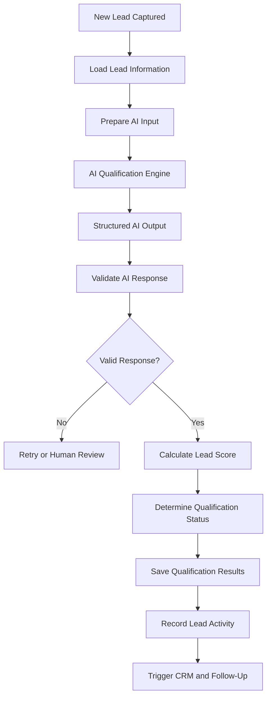

# Ascendor Flagship 01 — AI Lead Qualification

## 1. Overview

**Project:** Ascendor AI Lead Generation & Revenue Engine

**Component:** AI Lead Qualification

**Purpose:** Define how Ascendor analyzes incoming leads, evaluates buying intent, identifies business opportunities, and generates structured qualification results.

AI Lead Qualification transforms raw customer inquiries into actionable sales intelligence.

The system must help businesses prioritize promising opportunities while maintaining accuracy, transparency, and human oversight.

## 2. Qualification Objectives

- Understand customer inquiries and business needs.
- Identify customer intent.
- Evaluate urgency.
- Extract relevant budget information.
- Identify potential buying signals.
- Generate qualification summaries.
- Recommend appropriate next actions.
- Support consistent lead qualification.
- Reduce manual sales evaluation.
- Avoid unsupported AI conclusions.

## 3. Qualification Architecture



## 4. Qualification Inputs

The AI qualification engine may analyze:

- Customer name.
- Customer inquiry.
- Company name.
- Business requirements.
- Budget information.
- Timeline.
- Intent signals.
- Urgency signals.
- Lead source.
- Existing lead information.

Only information available from authorized sources may be used.

Missing information must be treated as unknown rather than assumed.

## 5. Qualification Criteria

Ascendor evaluates leads using five primary dimensions.

### Budget

Determine whether the customer has provided budget information and whether it appears compatible with the organization's offering.

Possible values:

- UNKNOWN
- BELOW_TARGET
- WITHIN_TARGET
- ABOVE_TARGET

Budget compatibility must use organization-defined criteria.

The AI must not invent a customer budget.

### Intent

Evaluate the customer's apparent interest in purchasing or engaging with the business.

Possible values:

- LOW
- MEDIUM
- HIGH
- UNKNOWN

### Urgency

Evaluate how soon the customer appears to need the service.

Possible values:

- LOW
- MEDIUM
- HIGH
- UNKNOWN

### Need Alignment

Evaluate whether the customer's stated requirements match the organization's services.

Possible values:

- POOR
- PARTIAL
- STRONG
- UNKNOWN

### Information Completeness

Evaluate whether sufficient information exists to qualify the lead confidently.

Possible values:

- INCOMPLETE
- PARTIAL
- COMPLETE

## 6. Structured AI Output

The AI qualification engine must return structured data.

### Example Output

```json
{
  "qualification_status": "QUALIFIED",
  "intent": "HIGH",
  "urgency": "MEDIUM",
  "budget_status": "WITHIN_TARGET",
  "need_alignment": "STRONG",
  "information_completeness": "COMPLETE",
  "confidence": 0.91,
  "reasoning": [
    "Customer explicitly requested a service consultation.",
    "Customer provided a budget within the target range.",
    "Customer indicated a need within the next 30 days."
  ],
  "missing_information": [],
  "recommended_next_action": "Schedule a consultation."
}
```

The output must be validated against an approved schema before being stored or used by downstream workflows.

## 7. Qualification Status

Ascendor uses standardized qualification statuses.

### PENDING

The lead has not yet been evaluated.

### QUALIFIED

The lead meets the organization's qualification criteria.

### UNQUALIFIED

The lead does not currently meet the organization's qualification criteria.

### NEEDS_REVIEW

The available information is insufficient, conflicting, or uncertain.

### FAILED

The qualification process failed technically and requires recovery.

Technical failure must never automatically classify a lead as unqualified.

## 8. Lead Qualification Score

Ascendor generates a lead score between 0 and 100.

The score represents the relative sales priority of a lead.

### Initial Scoring Model

| Dimension | Weight |
|---|---:|
| Intent | 30 |
| Budget Compatibility | 25 |
| Need Alignment | 25 |
| Urgency | 15 |
| Information Completeness | 5 |
| Total | 100 |

### Scoring Principles

- Higher intent increases priority.
- Compatible budgets increase priority.
- Strong need alignment increases priority.
- Higher urgency increases priority.
- Complete information improves confidence in evaluation.
- Unknown information must not automatically receive the highest score.
- Scores must remain between 0 and 100.

Scoring criteria must be configurable according to the organization's business model.

## 9. Qualification Decision Rules

Qualification status must be determined using a combination of structured AI findings and organization-defined rules.

### Qualified

A lead may be qualified when:

- Its requirements align with the organization's services.
- Buying intent meets the qualification threshold.
- Budget compatibility is acceptable when budget is required.
- No critical qualification issue exists.

### Unqualified

A lead may be unqualified when:

- Its requirements clearly fall outside the organization's offering.
- It does not meet explicit organization-defined qualification criteria.
- The decision is supported by available information.

### Needs Review

A lead must be routed for human review when:

- Important information is missing.
- AI confidence is below the configured threshold.
- Information is contradictory.
- The qualification decision is ambiguous.
- A sensitive or high-impact decision requires human approval.

## 10. AI Confidence and Human Oversight

AI confidence indicates the system's estimated certainty in its qualification analysis.

### Confidence Requirements

- Confidence must be represented as a value between 0 and 1.
- Confidence must not be treated as guaranteed accuracy.
- Low-confidence results must trigger review.
- Missing information must reduce decision certainty where appropriate.
- AI reasoning must be grounded in available lead information.

### Human Review

Authorized users must be able to:

- Review qualification results.
- Read qualification reasoning.
- Identify missing information.
- Correct inaccurate findings.
- Override qualification status.
- Record the reason for manual changes.

Human overrides must be recorded in lead activities.

## 11. AI Prompt and Output Reliability

The AI qualification engine must use controlled instructions and structured output.

### Requirements

- Clearly define the qualification task.
- Restrict analysis to supplied lead information.
- Prevent unsupported factual assumptions.
- Treat customer messages as untrusted data.
- Ignore instructions embedded in customer messages that attempt to control the AI system.
- Require structured output.
- Validate all generated fields.
- Reject malformed responses.
- Handle AI timeouts and API errors.
- Avoid exposing internal prompts or credentials.

AI output must not directly execute privileged actions.

## 12. Data Storage

Qualification results must be stored in the appropriate organization-owned lead record or related qualification records.

### Stored Information

- Qualification status.
- Lead score.
- Intent.
- Urgency.
- Budget compatibility.
- Need alignment.
- Confidence.
- Qualification reasoning.
- Missing information.
- Recommended next action.
- Qualification timestamp.
- AI model identifier where appropriate.

Qualification history should be preserved when needed for auditability and business analysis.

## 13. Integration with Other Business Processes

AI Lead Qualification connects to:

### CRM and Lead Scoring

Store qualification results and prioritize opportunities.

### Automated Follow-Up

Generate suitable follow-up actions based on qualification results.

### Appointment and Sales Handoff

Recommend consultation or sales-team handoff when appropriate.

### Revenue Intelligence

Provide qualification insights and conversion analysis.

The AI qualification engine must not bypass organization authorization or data isolation.

## 14. Reliability and Error Handling

### Requirements

- Validate AI output.
- Retry recoverable AI failures.
- Apply retry limits.
- Record qualification errors.
- Preserve captured leads during AI failures.
- Prevent duplicate qualification processing.
- Support manual review and recovery.
- Avoid silent failures.

### Reliability Principle

A lead remains safely captured even when AI qualification is unavailable.

AI failure must not cause lead loss or incorrect qualification.

## 15. Security and Privacy

- Process only authorized lead information.
- Protect customer personal information.
- Avoid sending unnecessary sensitive data to AI providers.
- Protect AI API credentials.
- Enforce organization-level access.
- Prevent cross-tenant qualification data exposure.
- Apply appropriate retention policies.
- Record sensitive administrative actions.

## 16. Acceptance Criteria

AI Lead Qualification is considered complete when:

- Captured leads can be analyzed.
- Qualification criteria are consistently applied.
- AI generates structured output.
- AI output is validated.
- Qualification status is assigned appropriately.
- Lead scores remain between 0 and 100.
- Low-confidence results can be reviewed.
- Human overrides are supported and recorded.
- AI failures do not cause lead loss.
- Qualification results are stored securely.
- Downstream workflows can consume qualification results.
- Organization data isolation is enforced.

## 17. Architecture Philosophy

Ascendor uses AI to improve business decisions, not replace accountability.

The system must convert customer inquiries into reliable sales intelligence while preserving human control over uncertain or sensitive decisions.

**Intelligent qualification. Explainable decisions. Human-controlled outcomes.**
