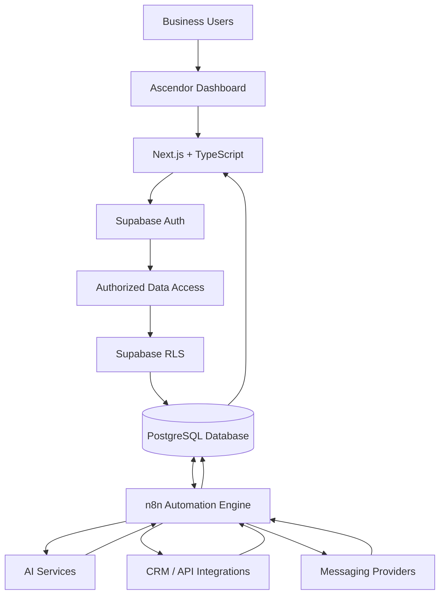
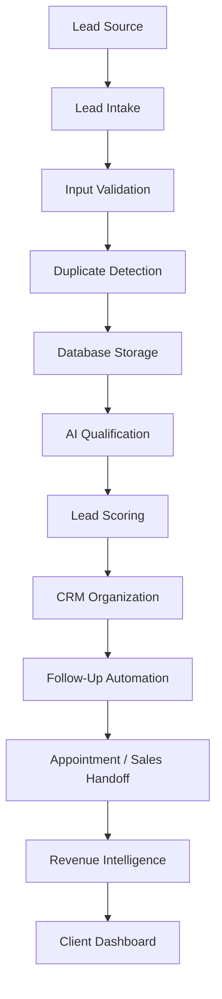

# Ascendor Flagship 01 — System Architecture

## 1. Project Overview

- **Project Name:** Ascendor AI Lead Generation & Revenue Engine
- **Project Type:** Multi-Tenant Business Automation Platform
- **Architecture Goal:** SaaS-Ready System Architecture

Ascendor AI Lead Generation & Revenue Engine is a business automation platform designed to help companies capture, qualify, organize, follow up with, and convert leads into revenue opportunities.

The system combines automation workflows, AI-powered lead intelligence, centralized business data, and an intuitive client dashboard.

The architecture is designed to support an initial implementation for individual businesses and future expansion into a multi-tenant SaaS platform.

---

## 2. Architecture Quality Requirements

All architectural decisions must satisfy the following four quality requirements.

### 2.1 Reliability

The system must operate predictably, protect business data, and recover from operational failures.

**Requirements:**

- Validate incoming data before processing.
- Prevent duplicate lead creation.
- Implement appropriate error handling and recovery.
- Maintain accurate and consistent business records.
- Protect client data through tenant isolation.
- Record important automation activities.
- Monitor system health and workflow failures.
- Implement automated testing for critical functionality.

### 2.2 Scalability

The system must support increasing clients, leads, workflows, and integrations without requiring a complete architectural redesign.

**Requirements:**

- Support multi-tenant organizations.
- Separate business logic into modular workflows.
- Use reusable automation components.
- Maintain an efficient database structure.
- Support increasing automation execution volume.
- Allow infrastructure expansion when necessary.
- Support future integration of all six Ascendor flagship ecosystems.

### 2.3 Premium / Aesthetic

The platform must provide a polished, professional, and consistent user experience.

**Requirements:**

- Maintain a consistent visual identity.
- Use clean layouts and organized information hierarchy.
- Apply consistent typography, spacing, and components.
- Provide professional business data visualization.
- Support responsive interfaces.
- Maintain consistency across dashboard modules.
- Deliver a polished experience across important user interactions.

### 2.4 Simple / Usable

The platform must remain intuitive and easy to use despite its sophisticated internal architecture.

**Requirements:**

- Provide intuitive navigation.
- Use understandable labels and actions.
- Minimize unnecessary user steps.
- Present business information clearly.
- Provide useful defaults.
- Communicate success, errors, and system status clearly.
- Hide unnecessary technical complexity from business users.
- Enable nontechnical business owners to operate the platform confidently.

### Architecture Philosophy

> Powerful underneath. Simple on the surface. Premium in every interaction.

---

## 3. System Architecture

### 3.1 Architectural Components

The system consists of the following primary components.

| Component | Technology | Responsibility |
|---|---|---|
| Client Dashboard | Next.js | User interface and business operations |
| Frontend Language | TypeScript | Type-safe frontend development |
| Styling | Tailwind CSS | Consistent design system |
| Database | Supabase PostgreSQL | Persistent business data |
| Authentication | Supabase Auth | User authentication |
| Authorization | Supabase RLS | Tenant-level data access control |
| Automation Engine | n8n | Workflow execution and orchestration |
| AI Services | LLM APIs | Lead qualification and business intelligence |
| Cloud Infrastructure | AWS (Future) | Production hosting and infrastructure expansion |

Python FastAPI may be introduced for specialized backend services when required. It is not mandatory for the initial architecture.

### 3.2 Architecture Diagram

**Architecture Requirements:**

- Authentication and authorization must be enforced before users access organization-specific information.
- Privileged automation credentials must remain server-side.
- Service-role credentials must never be exposed to the client dashboard.
- Database access must enforce organization-level authorization.

---

## 4. Component Responsibilities

### 4.1 Next.js Dashboard

The dashboard provides the primary user interface for Ascendor.

**Responsibilities:**

- Display leads and lead details.
- Display qualification results and lead scores.
- Display pipeline information.
- Display follow-up activities.
- Display appointments and sales handoffs.
- Display revenue intelligence.
- Allow authorized users to manage business records.
- Present automation status and relevant notifications.

The dashboard must prioritize usability over technical complexity.

### 4.2 Supabase

Supabase provides the core data and authentication infrastructure.

**Responsibilities:**

- Store organizations and organization memberships.
- Store leads and business records.
- Store lead activities and pipeline information.
- Store appointments and automation records.
- Authenticate users.
- Enforce authorization and tenant data isolation.
- Provide structured access to persistent business data.

Row Level Security policies must be designed and tested before production deployment.

### 4.3 n8n Automation Engine

n8n executes Ascendor's business automation processes.

**Responsibilities:**

- Receive lead intake events.
- Execute AI qualification workflows.
- Calculate or coordinate lead scoring.
- Trigger follow-up sequences.
- Coordinate appointment and sales handoff.
- Generate revenue intelligence data.
- Execute integrations with external business services.
- Record workflow execution results.
- Handle errors and retry eligible operations safely.

Workflows must be modular, reusable, and maintainable.

### 4.4 AI Services

AI services provide intelligence for selected business processes.

**Responsibilities:**

- Analyze lead information.
- Assist in lead qualification.
- Generate structured qualification outputs.
- Support personalized communication.
- Summarize business activities.
- Assist with revenue intelligence.

AI outputs must be validated before they modify important business records or trigger sensitive external actions.

### 4.5 Cloud Infrastructure

Cloud infrastructure will support production deployment and future scaling.

**Responsibilities:**

- Host application services.
- Host or support automation infrastructure.
- Support secure networking and service communication.
- Support backups and recovery.
- Support monitoring and operational management.
- Support infrastructure expansion when justified.

AWS is a future deployment target, not a requirement for the initial documentation or local development phase.

---

## 5. Six Core Business Processes

The architecture supports six core business processes.

### Process 01 — Lead Capture

Capture leads from supported sources, including:

- Website forms.
- Facebook lead integrations.
- Incoming business inquiries.
- Future external lead sources.

### Process 02 — AI Lead Qualification

Analyze incoming leads using:

- Customer needs.
- Budget.
- Intent.
- Urgency.
- Business fit.

Produce structured qualification results.

### Process 03 — CRM & Lead Scoring

Organize leads and prioritize opportunities using:

- Lead profiles.
- Qualification status.
- Lead scores.
- Pipeline stages.
- Assignment and ownership.
- Activity history.

### Process 04 — Automated Follow-Up

Coordinate follow-up activities through:

- Personalized email sequences.
- Reminders.
- Lead nurturing.
- Follow-up scheduling.
- Activity tracking.

### Process 05 — Appointment & Sales Handoff

Support sales execution through:

- Appointment scheduling.
- Sales notifications.
- Lead assignment.
- Sales team handoff.
- Appointment activity tracking.

### Process 06 — Revenue Intelligence

Provide business visibility through:

- Pipeline summaries.
- Lead conversion tracking.
- Revenue opportunity tracking.
- Lead performance reports.
- Automation performance information.

---

## 6. Data Flow

The primary business data flow is:

**Data Integrity Requirements:**

- Preserve lead identity throughout the business process.
- Maintain organization ownership of business records.
- Preserve relevant lead activity history.
- Record failed operations appropriately.
- Support recovery from failed automation operations.
- Prevent silent data loss.

---

## 7. Multi-Tenant Architecture

Ascendor is designed to support multiple organizations within a shared platform.

### 7.1 Tenant Model

Each business customer is represented by an organization.

Users may belong to one or more organizations through organization membership records.

Business records must be associated with the organization that owns them.

### 7.2 Tenant Isolation

The system must prevent one organization from accessing another organization's data.

**Requirements:**

- Organization ownership must be represented explicitly.
- Organization membership must be verified.
- Database access must enforce tenant restrictions.
- RLS policies must protect organization-specific records.
- Automation execution must preserve organization context.
- External integrations must use the correct organization's credentials.
- Cross-tenant access must be tested.

### 7.3 Tenant-Aware Automation

Automation workflows must identify the organization associated with every business event.

The system must not trust client-supplied organization identifiers without validating authorization.

Privileged automation access must be restricted and carefully controlled.

---

## 8. Security Architecture

Security must be incorporated into the architecture from the beginning.

**Requirements:**

- Authenticate users before granting protected access.
- Enforce authorization separately from authentication.
- Use Supabase Row Level Security.
- Protect API keys and service credentials.
- Never expose privileged service-role credentials in frontend code.
- Validate external webhook inputs.
- Protect sensitive business data.
- Restrict automation permissions.
- Log important security and operational events.
- Implement backup and recovery procedures.
- Test tenant isolation and authorization boundaries.

Production security must be validated before client deployment.

---

## 9. Reliability and Failure Handling

The system must be designed to handle operational failures.

**Requirements:**

- Validate incoming events.
- Apply duplicate detection and idempotency where necessary.
- Use appropriate retry policies.
- Avoid uncontrolled repeated execution.
- Record automation execution status.
- Track failed workflow operations.
- Support safe recovery and reprocessing.
- Prevent silent data loss.
- Monitor critical integrations.

Retries must be designed carefully for external actions such as sending emails or creating appointments to avoid duplicate side effects.

---

## 10. Scalability Strategy

The system will scale progressively.

### Stage 1 — Development

- Local development environment.
- Core database design.
- Initial automation workflows.
- Basic dashboard.
- Testing with sample data.

### Stage 2 — Client Implementation

- Configure organization-specific business processes.
- Connect supported external integrations.
- Implement organization-specific access.
- Validate business workflows.
- Deploy for initial client usage.

### Stage 3 — Managed Infrastructure

- Centralized deployment management.
- Monitoring and operational support.
- Backup and recovery.
- Secure tenant management.
- Infrastructure optimization.

### Stage 4 — SaaS Expansion

- Standardized onboarding.
- Multi-tenant customer management.
- Subscription and billing capabilities.
- Self-service configuration.
- Expanded integrations.
- Unified Ascendor product ecosystem.

Infrastructure must be expanded based on actual operational requirements rather than unnecessary complexity.

---

## 11. Future Ascendor Ecosystem Integration

Flagship 01 must be designed to integrate into the broader Ascendor platform.

### Future Flagship Ecosystems

1. AI Lead Generation & Revenue Engine.
2. AI Customer Support & Client Service Ecosystem.
3. E-commerce Operations Automation Ecosystem.
4. Complete Sales & CRM Automation Ecosystem.
5. Client Onboarding & Agency Operations Ecosystem.
6. The sixth flagship ecosystem, as defined in Ascendor's master project portfolio.

### Shared Future Platform Capabilities

- Organization management.
- Authentication and authorization.
- Shared customer data infrastructure.
- Unified dashboard.
- Shared automation infrastructure.
- Common integration management.
- Unified reporting and business intelligence.

The six flagship ecosystems must remain distinct business capabilities while operating within a unified Ascendor platform.

---

## 12. Architectural Principles

The following principles guide all future system design.

1. Reliability before unnecessary complexity.
2. Security and tenant isolation by design.
3. Modular and maintainable architecture.
4. Business logic separated from user interface.
5. Reusable automation components.
6. Data consistency and integrity.
7. User experience designed for nontechnical business owners.
8. Premium interface without unnecessary interaction complexity.
9. Infrastructure scaling based on business requirements.
10. SaaS expansion without sacrificing operational simplicity.

---

## 13. Architecture Acceptance Criteria

The architecture is considered ready for detailed implementation planning when:

- [ ] All system components and responsibilities are documented.
- [ ] The primary architecture and data flow are defined.
- [ ] Tenant isolation requirements are established.
- [ ] Security boundaries are identified.
- [ ] Reliability requirements are documented.
- [ ] Scalability strategy is defined.
- [ ] Dashboard usability requirements are established.
- [ ] All six core business processes are preserved.
- [ ] Future SaaS integration is considered.
- [ ] The architecture remains aligned with Ascendor's four quality requirements.

---

## 14. Architecture Philosophy

Ascendor builds sophisticated business automation systems that feel effortless to use.

- **Reliable in operation.**
- **Scalable in architecture.**
- **Premium in experience.**
- **Simple in execution.**

The objective is not merely to automate business processes.

The objective is to build a trusted business platform that helps companies capture opportunities, execute sales processes, and grow revenue.
