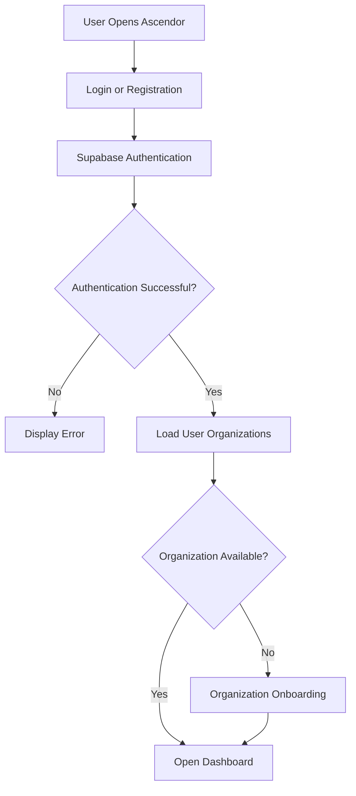

# Ascendor Flagship 01 — Authentication & Organization Model

## 1. Overview

**Project:** Ascendor AI Lead Generation & Revenue Engine

**Component:** Authentication & Organization Management

**Purpose:** Define how multiple users authenticate, access organizations, and collaborate securely within Ascendor.

Ascendor is designed as a multi-user, multi-tenant SaaS platform.

The platform must support multiple businesses, multiple users per business, and users belonging to multiple organizations without compromising security or usability.

## 2. Authentication Architecture

Ascendor uses Supabase Authentication to manage user identities and authentication sessions.

### Authentication Provider

- Supabase Auth
- Email and password authentication
- Email verification
- Secure session management
- Password reset
- Logout
- Future support for OAuth authentication

### Authentication Flow

## 3. Multi-User Architecture

Ascendor must support many users simultaneously.

### Requirements

- Multiple users can register independently.
- Multiple users can log in simultaneously.
- Users can access Ascendor from different devices.
- Multiple members can collaborate within one organization.
- User sessions are isolated.
- Authentication does not automatically grant access to organization data.
- Organization membership and permissions determine access.

## 4. Organization Model

An organization represents a business workspace inside Ascendor.

Each organization owns its business data and has independent membership and permissions.

### Organization Requirements

- An organization has a unique identifier.
- An organization has a name and unique slug.
- An organization can contain multiple members.
- An organization can own multiple leads, appointments, activities, and automation records.
- An organization has at least one owner.
- Organization data must remain isolated from other organizations.

### Organization Creation

1. A user registers and verifies their account.
2. The user creates an organization.
3. The system creates the organization record.
4. The creator becomes the initial organization owner.
5. The owner can invite additional members.
6. The organization becomes available in the user's workspace.

Organization creation and initial owner assignment must be performed securely and consistently.

## 5. Organization Membership

A user can belong to one or multiple organizations.

Membership connects a user account to an organization.

### Membership Requirements

- Membership must reference an existing user.
- Membership must reference an existing organization.
- A user cannot have duplicate membership records for the same organization.
- Each membership has an assigned role.
- Membership determines which organization the user can access.
- Removing membership revokes organization access.

## 6. Role-Based Access Control

Ascendor uses organization-level roles.

### Owner

The owner has the highest authority within an organization.

Permissions:

- Manage organization settings.
- Invite and remove members.
- Assign organization roles.
- Manage billing and subscriptions when implemented.
- Access all organization business data.
- Configure organization integrations.
- Manage automation settings.
- Transfer ownership through a secure process.

### Admin

The admin manages daily organization operations.

Permissions:

- View and manage leads.
- Manage pipeline stages.
- Manage appointments.
- Manage organization members where permitted.
- Configure operational settings.
- View automation logs.
- Access organization reports.

Restrictions:

- Cannot transfer organization ownership.
- Cannot override owner-only permissions.
- Cannot access other organizations.

### Member

The member performs assigned business operations.

Permissions:

- View permitted organization leads.
- Update permitted lead records.
- Manage assigned appointments.
- Record lead activities.
- Access permitted dashboard features.

Restrictions:

- Cannot manage organization ownership.
- Cannot modify organization security settings.
- Cannot assign privileged roles.
- Cannot access another organization's data.

Role permissions must be enforced by backend authorization and database policies, not merely hidden frontend buttons.

## 7. Organization Invitations

Organization owners and authorized administrators can invite users.

### Invitation Flow

1. Authorized user enters an invitee email.
2. System generates a secure invitation.
3. Invitation is associated with the organization and intended role.
4. Invitee receives an invitation.
5. Invitee authenticates or registers.
6. Invitee accepts the invitation.
7. Membership is created securely.
8. Invitee gains access to the organization according to their role.

### Invitation Security

- Invitations must expire.
- Invitation tokens must be securely generated.
- Invitations must be single-use.
- Only authorized roles can issue invitations.
- Invitation acceptance must validate the intended user.
- Invitation acceptance must not permit unauthorized role escalation.

## 8. Multiple Organizations per User

Ascendor supports users belonging to multiple organizations.

Example:

- User A belongs to Company Alpha as an Admin.
- User A belongs to Company Beta as a Member.
- User A belongs to Company Gamma as an Owner.

Each organization has separate membership and permissions.

### Organization Switching

Users can switch between organizations they are authorized to access.

When switching organizations:

- The active organization context changes.
- Dashboard data reloads.
- Organization-specific settings update.
- Permissions are evaluated for the selected organization.
- Previous organization data must not remain accessible through stale UI state.

The selected organization is not itself proof of authorization.

## 9. Multi-Tenant Data Isolation

Every organization-owned business record must contain an `organization_id`.

Examples:

- Leads
- Pipeline stages
- Lead activities
- Appointments
- Automation logs
- Organization-specific integrations

### Isolation Requirements

- Users can access only organizations where they have valid membership.
- Organization-owned records must be scoped to the authorized organization.
- Requests must not trust organization IDs supplied by the client without authorization checks.
- Database policies must enforce tenant isolation.
- Backend services and n8n workflows must validate organization context.
- Cross-organization data access must be prevented.

## 10. Supabase Row Level Security (RLS)

Supabase Row Level Security is a primary enforcement layer for organization data isolation.

### RLS Requirements

- RLS must be enabled on organization-owned tables.
- Policies must verify authenticated user identity.
- Policies must verify organization membership.
- Policies must enforce appropriate role permissions.
- Unauthorized cross-tenant access must be denied.
- Membership creation and role changes must use secure authorization rules.

RLS policies must be tested against multiple users and multiple organizations.

Privileged service credentials must never be exposed in the frontend.

## 11. Session Management

Ascendor uses secure authentication sessions.

### Requirements

- Secure login and logout.
- Session expiration and refresh.
- Password reset flow.
- Email verification.
- Unauthorized session handling.
- Protected dashboard routes.
- Clear feedback when a session expires.

Sensitive authentication tokens must not be exposed in URLs or logs.

## 12. Frontend Experience

The authentication and organization experience must follow Ascendor's four quality standards.

### Reliable

- Clear authentication feedback.
- Secure organization selection.
- Consistent session handling.
- No unauthorized dashboard access.

### Scalable

- Support multiple users and organizations.
- Support multiple memberships per user.
- Support organization-level roles.
- Support future subscription and billing integration.

### Premium / Aesthetic

- Clean login and registration pages.
- Consistent typography and spacing.
- Professional organization onboarding.
- Elegant organization switcher.
- Consistent visual feedback.

### Simple / Usable

- Easy registration and login.
- Minimal onboarding steps.
- Clear organization selection.
- Simple member invitations.
- Understandable permission boundaries.

## 13. Security Requirements

- Authentication must be handled by Supabase Auth.
- Authorization must be enforced server-side and through database policies.
- Organization membership must be verified before granting access.
- Users must not self-assign privileged roles.
- Users must not add themselves to arbitrary organizations.
- Ownership transfer must require authorized action.
- Sensitive credentials must remain server-side.
- Cross-tenant access must be prevented.
- Security-sensitive operations must be logged appropriately.

## 14. Acceptance Criteria

The authentication and organization model is considered complete when:

- Multiple users can register and authenticate.
- Multiple users can access the platform simultaneously.
- A user can create an organization.
- The organization creator becomes its initial owner.
- Owners can invite additional members.
- Members can accept invitations securely.
- Organization roles are enforced.
- Users can belong to multiple organizations.
- Users can switch between authorized organizations.
- Organization data is isolated.
- RLS policies enforce access control.
- Unauthorized access attempts are denied.
- Session expiration and logout work correctly.

## 15. Architecture Philosophy

Ascendor must support many businesses and many users without sacrificing security, simplicity, or reliability.

The authentication system must remain invisible in complexity while providing a secure and intuitive experience.

**Powerful underneath. Simple on the surface. Premium in every interaction.**
