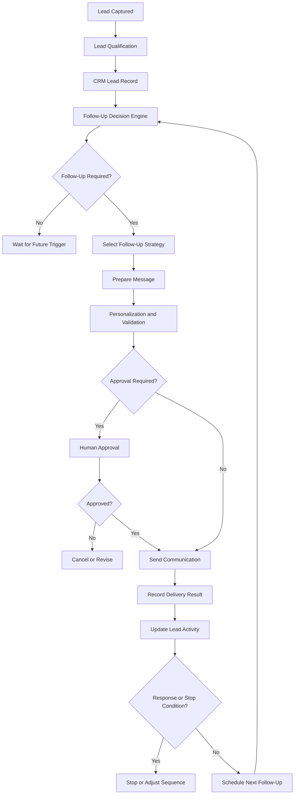

# Ascendor Flagship 01 — Automated Follow-Up

## 1. Overview

**Project:** Ascendor AI Lead Generation & Revenue Engine

**Component:** Automated Follow-Up

**Purpose:** Define how Ascendor automatically manages customer communication, follow-up scheduling, and lead nurturing throughout the sales process.

Automated Follow-Up helps businesses respond consistently, maintain customer engagement, and reduce opportunities lost through delayed responses or missed follow-ups.

The system must automate communication responsibly while preserving human control, customer preferences, and organization-specific communication policies.

## 2. Follow-Up Objectives

- Respond to new leads promptly.
- Automate personalized follow-up communication.
- Maintain consistent lead nurturing.
- Reduce missed follow-up opportunities.
- Schedule follow-up activities automatically.
- Adapt communication to lead qualification results.
- Track communication delivery and outcomes.
- Respect customer communication preferences.
- Stop communication when appropriate.
- Support human approval for sensitive communications.
- Maintain organization-specific communication settings.

## 3. Follow-Up Architecture

## 4. Follow-Up Triggers

Ascendor may initiate follow-up sequences based on business events.

### New Lead Captured

A newly captured lead may receive an initial acknowledgment or response.

### Lead Qualified

Qualified leads may enter a sales-focused follow-up sequence.

### Lead Not Contacted

Leads without recorded contact activity may trigger a follow-up reminder or communication.

### Appointment Completed

Completed appointments may trigger a thank-you message or next-step communication.

### Proposal Sent

A proposal may trigger scheduled follow-up reminders based on organization-defined timing.

### Inactive Lead

Leads without meaningful engagement may enter an appropriate nurturing sequence.

### Manual Trigger

Authorized organization members may initiate, pause, resume, or cancel follow-up sequences.

## 5. Follow-Up Strategies

Ascendor supports organization-defined communication strategies.

### Immediate Response

Acknowledge a new inquiry and communicate the next expected step.

### Sales Follow-Up

Encourage qualified leads to schedule consultations, discuss requirements, or proceed with a sales conversation.

### Proposal Follow-Up

Follow up on proposals and identify outstanding questions or decisions.

### Lead Nurturing

Maintain appropriate communication with leads who are not yet ready to purchase.

### Re-Engagement

Reconnect with inactive leads when permitted by their communication preferences and applicable policies.

Follow-up strategies must be configurable according to the organization's business model.

## 6. Personalized Communication

Ascendor may use AI to prepare personalized communication.

### Personalization Inputs

- Customer name.
- Company name.
- Original inquiry.
- Lead qualification results.
- Customer requirements.
- Relevant previous interactions.
- Appointment information.
- Proposal context.
- Organization communication preferences.

### Personalization Requirements

- Use only authorized and available information.
- Avoid inventing customer details.
- Avoid unsupported promises.
- Maintain the organization's approved tone.
- Produce clear and professional messages.
- Validate generated content before sending.
- Prevent sensitive information from being disclosed improperly.

AI-generated messages must remain grounded in actual lead information.

## 7. Follow-Up Message Types

### Email

Email is the primary communication channel for the MVP.

Supported message categories:

- Inquiry acknowledgment.
- Personalized sales response.
- Consultation invitation.
- Appointment confirmation.
- Appointment reminder.
- Proposal follow-up.
- Post-meeting follow-up.
- Lead nurturing.
- Re-engagement.

### Future Communication Channels

Potential future integrations:

- SMS.
- WhatsApp.
- Facebook Messenger.
- Other organization-authorized messaging platforms.

Additional channels must be implemented with appropriate consent, security, and provider requirements.

## 8. Follow-Up Scheduling

Ascendor must support configurable follow-up schedules.

### Scheduling Requirements

- Organization-defined follow-up intervals.
- Business-hour restrictions.
- Time-zone-aware scheduling.
- Delayed communication.
- Scheduled reminders.
- Sequence pause and resume.
- Sequence cancellation.
- Maximum follow-up limits.

### Example Follow-Up Sequence

| Timing | Action |
|---|---|
| Immediately | Acknowledge inquiry |
| After 1 day | Send relevant follow-up |
| After 3 days | Check customer engagement |
| After 7 days | Send final scheduled follow-up |
| After sequence ends | Move to nurturing or stop |

This sequence is illustrative and must be configurable.

Follow-up schedules must not continue indefinitely without defined limits.

## 9. Follow-Up Stop Conditions

Ascendor must stop or modify communication when appropriate.

### Stop Conditions

- Customer replies.
- Customer books an appointment.
- Lead becomes converted.
- Lead is marked Lost.
- Customer unsubscribes.
- Customer requests no further communication.
- Organization member manually stops the sequence.
- Communication becomes inappropriate or unauthorized.

### Requirements

- Stop conditions must be checked before sending.
- Scheduled messages must be revalidated before execution.
- Unsubscribe requests must be respected.
- Suppression rules must apply across relevant organization communication sequences.
- Stopped sequences must not resume automatically without an authorized trigger.

## 10. Human Approval

Ascendor must support human approval for sensitive or high-impact communications.

### Approval Requirements

- Organizations can configure approval policies.
- Sensitive messages can require approval.
- Authorized users can approve or reject messages.
- Rejected messages can be revised.
- Approval decisions must be recorded.
- Approval requests must expire where appropriate.
- Messages must not be sent before required approval.

### Examples Requiring Approval

- Negotiation-related communication.
- Custom pricing or discount offers.
- Contractual commitments.
- High-value proposals.
- Sensitive customer situations.
- Messages involving unsupported business commitments.

Routine approved communication may be automated according to organization policy.

## 11. Communication Delivery Tracking

Ascendor must track communication outcomes.

### Delivery Statuses

- PENDING
- APPROVAL_REQUIRED
- APPROVED
- SCHEDULED
- SENT
- DELIVERED
- FAILED
- CANCELLED
- REJECTED

Delivery status must reflect actual provider information when available.

A successful API submission must not automatically be interpreted as confirmed delivery.

### Tracking Requirements

- Record message creation.
- Record approval decisions.
- Record send attempts.
- Record provider responses.
- Record delivery events when available.
- Record failures.
- Associate messages with the correct organization and lead.
- Preserve appropriate communication history.

## 12. Retry and Failure Handling

Automated Follow-Up must handle communication failures reliably.

### Requirements

- Retry recoverable failures.
- Apply retry limits.
- Use controlled retry intervals.
- Avoid duplicate message delivery where possible.
- Record failed attempts.
- Support manual recovery.
- Prevent repeated execution from creating duplicate scheduled messages.
- Handle provider rate limits.
- Handle authentication failures.
- Handle temporary service outages.

### Reliability Principle

A communication failure must be visible and recoverable.

Ascendor must never silently discard an important scheduled follow-up.

## 13. Follow-Up Workflow Management

Organizations must be able to manage their follow-up operations.

### Management Actions

Authorized users can:

- View active follow-up sequences.
- View scheduled messages.
- Review communication history.
- Pause sequences.
- Resume sequences.
- Cancel sequences.
- Approve pending messages.
- Review failed communications.
- Manually initiate follow-up.

Management permissions must be organization-specific.

## 14. Multi-Tenant Communication Security

Every communication must belong to the correct organization.

### Security Requirements

- Organization context must be validated.
- Leads must belong to the sending organization.
- Communication credentials must be organization-specific where applicable.
- Users must only access authorized communication records.
- Customer personal information must be protected.
- Credentials must not be exposed in frontend code.
- Cross-tenant communication must be prevented.
- Organization-specific sender identities must be respected.

## 15. Communication Compliance

Ascendor must support responsible communication practices.

### Requirements

- Respect customer consent and communication preferences.
- Support unsubscribe mechanisms where applicable.
- Maintain suppression lists.
- Apply organization communication policies.
- Respect applicable email and messaging regulations.
- Avoid misleading or deceptive messages.
- Avoid excessive communication frequency.
- Preserve relevant communication records.

Compliance requirements must be evaluated according to the organization's jurisdiction and communication channels.

## 16. Follow-Up Data Management

Follow-Up must maintain appropriate records.

### Communication Records

- Organization ID.
- Lead ID.
- Communication channel.
- Message type.
- Message content or approved reference.
- Delivery status.
- Scheduled timestamp.
- Sent timestamp.
- Provider message ID where available.
- Approval status.
- Error details where applicable.
- Created timestamp.

### Sequence Records

- Organization ID.
- Lead ID.
- Sequence name.
- Sequence status.
- Current sequence position.
- Next scheduled action.
- Started timestamp.
- Completed timestamp.
- Cancellation reason where applicable.

Communication records must follow appropriate retention and privacy policies.

## 17. Integration with Other Business Processes

Automated Follow-Up connects to:

### Lead Capture

Initiate appropriate responses after a lead is captured.

### AI Lead Qualification

Adapt communication according to qualification results.

### CRM and Lead Scoring

Use lead status, score, ownership, and activity history to determine follow-up priorities.

### Appointment and Sales Handoff

Coordinate appointment confirmations, reminders, and post-meeting communication.

### Revenue Intelligence

Provide communication activity and engagement information for business analysis.

Follow-Up must respect the state and authorization rules of all connected processes.

## 18. Future Dashboard Experience

Automated Follow-Up must follow Ascendor's four quality standards.

### Reliable

- Accurate communication status.
- Visible delivery failures.
- Controlled retries.
- Clear approval history.
- Reliable stop conditions.

### Scalable

- Support multiple organizations.
- Support multiple communication sequences.
- Support increasing communication volumes.
- Support additional communication channels.
- Support organization-specific policies.

### Premium / Aesthetic

- Clean communication timeline.
- Professional message previews.
- Clear sequence visualization.
- Consistent typography and spacing.
- Elegant approval interface.

### Simple / Usable

- Easy sequence management.
- Clear scheduled actions.
- Simple approval and rejection.
- Understandable communication status.
- Minimal unnecessary configuration.

## 19. Acceptance Criteria

Automated Follow-Up is considered complete when:

- New leads can trigger appropriate communication.
- Follow-up sequences can be configured.
- AI can prepare personalized messages.
- Messages can be validated before sending.
- Human approval can be enforced.
- Follow-ups can be scheduled.
- Stop conditions are enforced.
- Communication delivery status is tracked.
- Failed communications can be recovered.
- Duplicate scheduled messages are prevented where possible.
- Communication records are stored securely.
- Organization-specific communication settings are respected.
- Unsubscribe and suppression rules are enforced.
- Follow-Up integrates with the other business processes.

## 20. Architecture Philosophy

Ascendor must ensure that every legitimate business opportunity receives timely and appropriate communication.

Automation must improve consistency without sacrificing customer trust, business accountability, or communication control.

**Timely communication. Intelligent follow-up. Respectful automation.**
