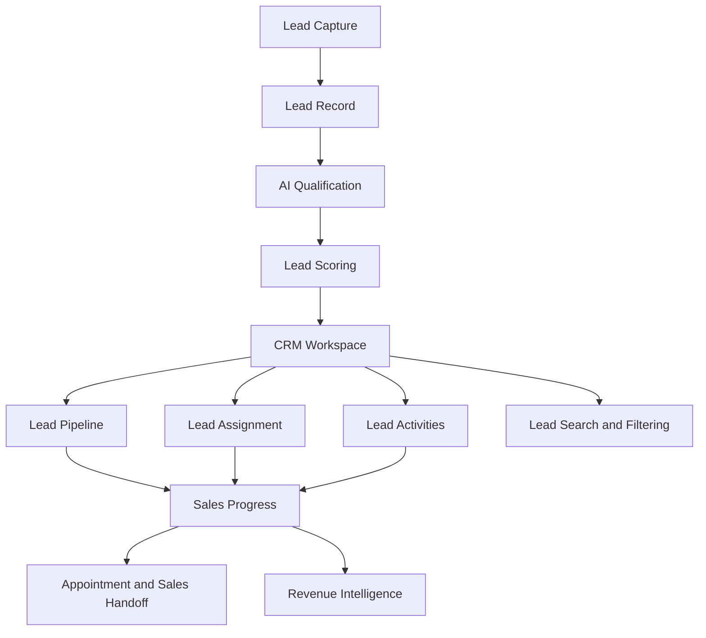

# Ascendor Flagship 01 — CRM & Lead Scoring

## 1. Overview

**Project:** Ascendor AI Lead Generation & Revenue Engine

**Component:** CRM & Lead Scoring

**Purpose:** Define how Ascendor organizes, manages, prioritizes, and tracks business leads throughout the sales pipeline.

CRM & Lead Scoring transforms captured and qualified leads into organized sales opportunities.

The system must provide businesses with a clear understanding of their leads, sales pipeline, customer interactions, and revenue opportunities.

## 2. CRM Objectives

- Centralize business leads in one workspace.
- Organize leads into sales pipeline stages.
- Track lead status and qualification results.
- Prioritize opportunities using lead scores.
- Assign leads to authorized team members.
- Record lead activities and interactions.
- Support multiple users collaborating within an organization.
- Provide efficient lead search, filtering, and management.
- Maintain accurate organization-specific CRM data.
- Support future revenue intelligence and reporting.

## 3. CRM Architecture



## 4. Organization-Specific CRM

Every organization has its own CRM workspace.

### Requirements

- Leads belong to a specific organization.
- Pipeline stages belong to a specific organization.
- Lead activities belong to a specific organization.
- Lead assignments must reference authorized organization members.
- CRM records must remain isolated between organizations.
- Organization members can collaborate according to their assigned permissions.
- CRM access must be enforced through backend authorization and Supabase RLS.

## 5. Lead Management

Ascendor must provide centralized lead management.

### Lead Information

Each lead may contain:

- Full name.
- Email address.
- Phone number.
- Company name.
- Lead source.
- Inquiry message.
- Budget information.
- Estimated revenue.
- Intent.
- Urgency.
- Qualification status.
- Lead score.
- Pipeline stage.
- Assigned sales representative.
- Created timestamp.
- Updated timestamp.

### Lead Management Actions

Authorized users can:

- View leads.
- Create leads.
- Update lead information.
- Assign leads.
- Move leads between pipeline stages.
- Review qualification results.
- Record activities.
- Search and filter leads.
- Archive or manage inactive leads according to organization policies.

## 6. Sales Pipeline

The CRM must provide a visual representation of the sales process.

### Default Pipeline Stages

1. New
2. Qualified
3. Contacted
4. Meeting Scheduled
5. Proposal Sent
6. Negotiation
7. Won
8. Lost

### Pipeline Requirements

- Organizations can configure pipeline stages.
- Pipeline stages have a defined order.
- Leads can move between stages.
- Pipeline changes must be recorded.
- Stage changes must update the lead record.
- Won and Lost stages represent terminal sales outcomes.
- Organizations may customize their pipeline according to their business model.

### Pipeline Visualization

The future dashboard should support a Kanban-style pipeline.

```text
NEW
 |
 v
QUALIFIED
 |
 v
CONTACTED
 |
 v
MEETING SCHEDULED
 |
 v
PROPOSAL SENT
 |
 v
NEGOTIATION
 |
 +------> WON
 |
 +------> LOST
```

## 7. Lead Scoring

Ascendor uses lead scoring to prioritize sales opportunities.

Lead scoring represents the relative sales priority of a lead based on available information and qualification results.

### Scoring Range

`0–100`

### Initial Scoring Dimensions

| Dimension | Weight |
|---|---:|
| Buying Intent | 30 |
| Budget Compatibility | 25 |
| Need Alignment | 25 |
| Urgency | 15 |
| Information Completeness | 5 |
| Total | 100 |

### Scoring Requirements

- Lead scores must remain between 0 and 100.
- Scoring criteria must be consistent.
- Scoring must reflect available lead information.
- Missing information must not automatically receive maximum points.
- Organization-specific scoring configuration may be supported.
- Score changes must be traceable.
- Qualification status and lead score must remain separate concepts.

### Lead Priority Categories

| Score | Priority |
|---|---|
| 80–100 | High |
| 50–79 | Medium |
| 0–49 | Low |

Priority categories may be configurable by organization.

## 8. Lead Assignment

Ascendor must support assigning leads to organization members.

### Assignment Requirements

- Leads can be assigned to authorized organization members.
- Assignment must remain organization-specific.
- Users must not assign leads to members of another organization.
- Assignment changes must be recorded.
- Assigned users should receive appropriate notifications.
- Leads may remain unassigned when no assignment is required.

### Future Assignment Strategies

- Manual assignment.
- Round-robin assignment.
- Assignment based on workload.
- Assignment based on sales specialization.
- Assignment based on lead source.

Advanced assignment strategies may be introduced after the MVP.

## 9. Lead Activity History

Ascendor must maintain an activity history for each lead.

### Activity Types

- Lead created.
- Lead updated.
- Lead assigned.
- Lead reassigned.
- Lead qualified.
- Qualification reviewed.
- Pipeline stage changed.
- Email sent.
- Email received.
- Appointment scheduled.
- Appointment completed.
- Sales note added.
- Lead converted.
- Lead marked as lost.

### Activity Requirements

- Activities must reference the correct organization.
- Activities must reference the relevant lead.
- Activities must include a timestamp.
- Activities should identify the actor when applicable.
- Automated activities must identify their originating workflow.
- Human actions must identify the responsible user.
- Activity history must be protected from unauthorized modification.

Activity history supports operational transparency and future auditability.

## 10. CRM Search and Filtering

Ascendor must make lead discovery simple and efficient.

### Search

Users should be able to search leads using:

- Customer name.
- Email.
- Phone.
- Company name.

### Filters

Users should be able to filter by:

- Lead source.
- Qualification status.
- Lead score.
- Pipeline stage.
- Assigned user.
- Lead creation date.
- Lead priority.

### Sorting

Users should be able to sort by:

- Creation date.
- Updated date.
- Lead score.
- Customer name.
- Estimated revenue.

Search and filtering must operate only within the user's authorized organization.

## 11. Lead Conversion and Sales Outcomes

Ascendor must track meaningful sales outcomes.

### Won Leads

When a lead becomes a customer:

- Mark the lead as Won.
- Record the conversion timestamp.
- Record actual revenue when available.
- Preserve relevant sales activities.
- Trigger appropriate downstream reporting.

### Lost Leads

When an opportunity is lost:

- Mark the lead as Lost.
- Record the loss reason when available.
- Preserve the sales history.
- Exclude the opportunity from active pipeline calculations.

### Conversion Requirements

- Sales outcomes must be recorded consistently.
- Revenue values must use appropriate currency representation.
- Conversion data must remain organization-specific.
- Conversion events must be available for Revenue Intelligence.

## 12. CRM Data Integrity

CRM operations must preserve database consistency.

### Requirements

- Leads must reference valid organizations.
- Pipeline stages must belong to the same organization as their leads.
- Assigned users must be authorized organization members.
- Activities must reference valid leads.
- Pipeline stage changes must preserve valid stage relationships.
- Lead scores must remain within the permitted range.
- Required fields must be validated.
- Invalid updates must be rejected.
- Database constraints must enforce critical integrity rules.

Cross-organization references must be prevented through database constraints and authorization policies where appropriate.

## 13. CRM Reliability

### Requirements

- Lead updates must be persisted reliably.
- Pipeline changes must not silently fail.
- Assignment changes must be recorded.
- Activity history must remain consistent.
- Database failures must produce understandable feedback.
- Concurrent updates must be handled safely.
- Automation-generated changes must be traceable.
- Critical operations must support recovery where appropriate.

### Reliability Principle

CRM data must remain accurate and trustworthy even when multiple users and automation workflows operate simultaneously.

## 14. Multi-User Collaboration

Ascendor CRM must support teams working together.

### Requirements

- Multiple users can access the same organization CRM.
- Users can view shared organization leads according to permissions.
- Leads can be assigned to individual members.
- Users can review lead activities.
- Pipeline changes are visible to authorized members.
- Concurrent updates must not silently overwrite important information.
- Organization-level permissions must be enforced.

## 15. Security Requirements

- Enforce organization-level access control.
- Use Supabase RLS for tenant isolation.
- Validate user permissions before sensitive CRM operations.
- Prevent unauthorized lead assignment.
- Prevent cross-tenant pipeline references.
- Protect lead personal information.
- Restrict sensitive administrative actions.
- Record important user and automation activities.
- Never expose privileged database credentials in the frontend.

## 16. Future CRM Dashboard

The CRM interface must follow Ascendor's four quality standards.

### Reliable

- Accurate lead information.
- Consistent pipeline updates.
- Traceable activity history.
- Clear error feedback.

### Scalable

- Support many organizations.
- Support multiple members per organization.
- Support large lead volumes.
- Support configurable pipeline stages.
- Support future CRM integrations.

### Premium / Aesthetic

- Clean pipeline visualization.
- Professional lead cards.
- Consistent typography and spacing.
- Clear visual hierarchy.
- Responsive dashboard design.

### Simple / Usable

- Easy lead search.
- Intuitive pipeline movement.
- Clear lead priority indicators.
- Minimal unnecessary actions.
- Simple assignment and activity recording.
- Understandable sales information.

## 17. Acceptance Criteria

CRM & Lead Scoring is considered complete when:

- Leads can be managed within an organization.
- Pipeline stages are configurable.
- Leads can move between pipeline stages.
- Lead scores are calculated consistently.
- Lead priorities are visible.
- Leads can be assigned to organization members.
- Lead activities are recorded.
- Search and filtering work correctly.
- Won and Lost outcomes are recorded.
- Multiple organization members can collaborate.
- Cross-tenant data access is prevented.
- CRM data integrity is enforced.
- CRM operations are reliable and traceable.

## 18. Architecture Philosophy

Ascendor CRM must transform scattered inquiries into organized, prioritized, and actionable sales opportunities.

The system should give business owners and sales teams immediate clarity about:

- Who their leads are.
- Which opportunities matter most.
- What stage each opportunity occupies.
- Who is responsible for each lead.
- What happened previously.
- What action should happen next.

**Organized opportunities. Intelligent prioritization. Clear sales visibility.**
