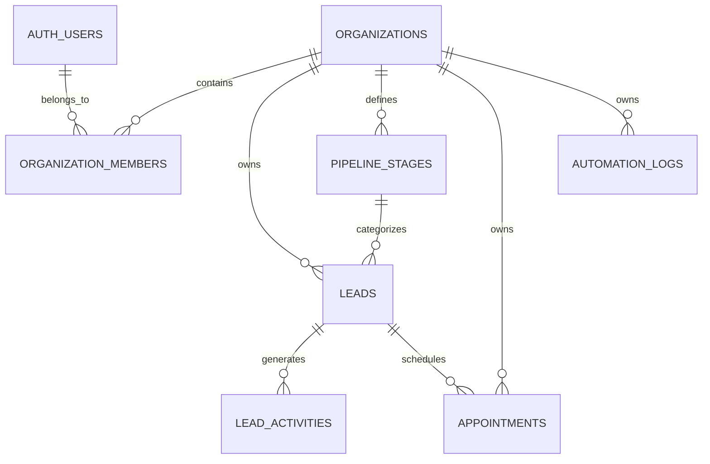

# Ascendor Flagship 01 — Multi-Tenant Database Design

## 1. Database Overview

### 1.1 Purpose

This document defines the database architecture for Ascendor AI Lead Generation & Revenue Engine.

The database is responsible for storing, organizing, protecting, and maintaining the integrity of business data across multiple organizations.

The design supports:

- Multi-tenant business operations.
- Lead management and qualification.
- Sales pipeline organization.
- Lead activity tracking.
- Appointment management.
- Automation execution monitoring.
- Future SaaS expansion.

### 1.2 Database Technology

| Component | Technology |
|---|---|
| Database Engine | PostgreSQL |
| Database Platform | Supabase |
| Authentication | Supabase Auth |
| Authorization | PostgreSQL Row Level Security (RLS) |
| Database Access | Supabase Client / Secure Backend |
| Automation Integration | n8n |

### 1.3 Database Design Principles

The database must follow these principles:

- Data integrity.
- Referential integrity.
- Tenant isolation.
- Secure authorization.
- Consistent relationships.
- Efficient querying.
- Scalable structure.
- Maintainable design.
- Reliable data storage.

---

## 2. Multi-Tenant Data Model

Ascendor uses a shared database architecture with logical tenant isolation.

Each business customer is represented by an organization.

Every organization owns its business records, including leads, activities, appointments, and automation records.

Users access organization data through authorized organization memberships.

### 2.1 Tenant Relationship

The diagram represents the conceptual relationships between database entities.

---

## 3. Database Tables

The initial database design includes the following tables.

| Table | Purpose |
|---|---|
| `organizations` | Store business organizations |
| `organization_members` | Connect users to organizations |
| `leads` | Store business prospects and opportunities |
| `pipeline_stages` | Define organization-specific sales stages |
| `lead_activities` | Record lead-related activities |
| `appointments` | Store scheduled appointments |
| `automation_logs` | Record automation execution events |

---

## 4. Organizations

### Table: `organizations`

Stores business customers registered within Ascendor.

| Column | Data Type | Description |
|---|---|---|
| `id` | UUID | Primary identifier |
| `name` | TEXT | Organization name |
| `slug` | TEXT | Unique organization identifier |
| `created_at` | TIMESTAMPTZ | Creation timestamp |
| `updated_at` | TIMESTAMPTZ | Last update timestamp |

### Requirements

- Each organization must have a unique identifier.
- Organization slugs must be unique.
- Organization records must be protected from unauthorized access.
- Organization creation must establish an authorized owner membership.

---

## 5. Organization Members

### Table: `organization_members`

Connects authenticated users to organizations.

| Column | Data Type | Description |
|---|---|---|
| `id` | UUID | Primary identifier |
| `organization_id` | UUID | Associated organization |
| `user_id` | UUID | Supabase Auth user |
| `role` | TEXT | Organization membership role |
| `created_at` | TIMESTAMPTZ | Membership creation timestamp |

### Membership Roles

| Role | Permissions |
|---|---|
| `owner` | Full organization management |
| `admin` | Administrative organization access |
| `member` | Authorized business operations |

### Requirements

- Each membership must reference an existing organization.
- Each membership must reference an authenticated user.
- A user must not have duplicate membership records for the same organization.
- Membership roles must be validated against permitted values.
- Organization membership must be verified before accessing tenant data.
- Owner privileges must be protected from unauthorized assignment.

---

## 6. Leads

### Table: `leads`

Stores incoming business prospects and sales opportunities.

| Column | Data Type | Description |
|---|---|---|
| `id` | UUID | Primary identifier |
| `organization_id` | UUID | Owning organization |
| `full_name` | TEXT | Lead's full name |
| `email` | TEXT | Lead's email address |
| `phone` | TEXT | Lead's phone number |
| `company_name` | TEXT | Lead's company |
| `source` | TEXT | Lead acquisition source |
| `status` | TEXT | Lead lifecycle status |
| `qualification_status` | TEXT | AI qualification status |
| `lead_score` | INTEGER | Lead priority score |
| `budget` | NUMERIC | Estimated customer budget |
| `estimated_revenue` | NUMERIC | Estimated opportunity value |
| `intent` | TEXT | Lead purchase intent |
| `urgency` | TEXT | Lead urgency |
| `pipeline_stage_id` | UUID | Associated pipeline stage |
| `assigned_to` | UUID | Assigned organization member |
| `created_at` | TIMESTAMPTZ | Lead creation timestamp |
| `updated_at` | TIMESTAMPTZ | Last update timestamp |

### Lead Statuses

- `NEW`
- `QUALIFIED`
- `UNQUALIFIED`
- `CONTACTED`
- `CONVERTED`
- `LOST`

### Qualification Statuses

- `PENDING`
- `PROCESSING`
- `QUALIFIED`
- `UNQUALIFIED`
- `FAILED`

### Requirements

- Every lead must belong to an organization.
- Lead scores must remain within the defined scoring range.
- Lead statuses must use valid values.
- Qualification statuses must use valid values.
- Pipeline stages must belong to the same organization as the lead.
- Assigned users must be authorized members of the lead's organization.
- Lead creation must support duplicate detection and idempotency.
- Lead records must preserve relevant business activity history.

---

## 7. Pipeline Stages

### Table: `pipeline_stages`

Defines organization-specific sales pipeline stages.

| Column | Data Type | Description |
|---|---|---|
| `id` | UUID | Primary identifier |
| `organization_id` | UUID | Owning organization |
| `name` | TEXT | Pipeline stage name |
| `position` | INTEGER | Stage display order |
| `is_default` | BOOLEAN | Default stage indicator |
| `created_at` | TIMESTAMPTZ | Creation timestamp |

### Requirements

- Pipeline stages must belong to an organization.
- Stage ordering must be maintained.
- Organizations may customize their pipeline stages.
- Default stages must be established during organization setup.
- Leads must only reference stages belonging to their organization.

---

## 8. Lead Activities

### Table: `lead_activities`

Records activities associated with individual leads.

| Column | Data Type | Description |
|---|---|---|
| `id` | UUID | Primary identifier |
| `organization_id` | UUID | Owning organization |
| `lead_id` | UUID | Associated lead |
| `activity_type` | TEXT | Activity category |
| `description` | TEXT | Activity description |
| `metadata` | JSONB | Additional structured information |
| `created_by` | UUID | User or authorized system actor |
| `created_at` | TIMESTAMPTZ | Activity timestamp |

### Activity Types

Examples:

- `LEAD_CREATED`
- `LEAD_UPDATED`
- `AI_QUALIFIED`
- `SCORE_UPDATED`
- `EMAIL_SENT`
- `FOLLOW_UP_SCHEDULED`
- `APPOINTMENT_BOOKED`
- `STATUS_CHANGED`
- `SALES_HANDOFF`

### Requirements

- Activities must belong to an organization.
- Activities must reference an existing lead.
- Activity history must be preserved.
- Activity records must not be silently deleted during normal operations.
- Metadata must contain valid structured data.

---

## 9. Appointments

### Table: `appointments`

Stores appointments associated with leads and organizations.

| Column | Data Type | Description |
|---|---|---|
| `id` | UUID | Primary identifier |
| `organization_id` | UUID | Owning organization |
| `lead_id` | UUID | Associated lead |
| `title` | TEXT | Appointment title |
| `scheduled_at` | TIMESTAMPTZ | Appointment date and time |
| `duration_minutes` | INTEGER | Appointment duration |
| `status` | TEXT | Appointment status |
| `assigned_to` | UUID | Assigned organization member |
| `created_at` | TIMESTAMPTZ | Creation timestamp |
| `updated_at` | TIMESTAMPTZ | Last update timestamp |

### Appointment Statuses

- `SCHEDULED`
- `CONFIRMED`
- `COMPLETED`
- `CANCELLED`
- `NO_SHOW`

### Requirements

- Appointments must belong to an organization.
- Appointments must reference a lead from the same organization.
- Assigned users must belong to the same organization.
- Appointment dates must be stored consistently.
- Appointment statuses must use valid values.

---

## 10. Automation Logs

### Table: `automation_logs`

Records important automation execution events.

| Column | Data Type | Description |
|---|---|---|
| `id` | UUID | Primary identifier |
| `organization_id` | UUID | Associated organization |
| `lead_id` | UUID | Related lead, if applicable |
| `workflow_name` | TEXT | Automation workflow name |
| `execution_id` | TEXT | External workflow execution identifier |
| `status` | TEXT | Execution status |
| `error_message` | TEXT | Error details, if applicable |
| `metadata` | JSONB | Additional execution information |
| `started_at` | TIMESTAMPTZ | Execution start timestamp |
| `completed_at` | TIMESTAMPTZ | Execution completion timestamp |
| `created_at` | TIMESTAMPTZ | Record creation timestamp |

### Automation Statuses

- `PENDING`
- `RUNNING`
- `SUCCESS`
- `FAILED`
- `CANCELLED`

### Requirements

- Automation records must preserve organization context.
- Execution identifiers should support tracing and deduplication.
- Failed executions must be recorded.
- Sensitive credentials must never be stored in logs.
- Error messages must not expose unnecessary sensitive information.
- Logs must support troubleshooting and operational monitoring.

---

## 11. Database Relationships

The database must maintain the following relationships.

| Relationship | Description |
|---|---|
| Organization → Members | An organization may have multiple members |
| Organization → Leads | An organization may own multiple leads |
| Organization → Pipeline Stages | An organization may define multiple pipeline stages |
| Lead → Activities | A lead may have multiple activity records |
| Lead → Appointments | A lead may have multiple appointments |
| Organization → Automation Logs | An organization may have multiple automation records |
| Pipeline Stage → Leads | A pipeline stage may contain multiple leads |

### Referential Integrity Requirements

- Foreign keys must protect database relationships.
- Organization ownership must remain consistent across related records.
- Cross-tenant relationships must be prevented.
- Required relationships must not reference nonexistent records.
- Deletion behavior must preserve important business history.

---

## 12. Data Integrity and Constraints

The database must enforce important business rules.

### 12.1 Primary Keys

- All primary identifiers must use UUIDs.
- Every table must have a primary key.

### 12.2 Foreign Keys

- Organization-owned records must reference valid organizations.
- Lead activities must reference valid leads.
- Appointments must reference valid leads.
- Pipeline stages must reference valid organizations.
- Assigned users must be validated against organization membership.

### 12.3 Validation Constraints

- Lead scores must remain within the permitted range.
- Required fields must not be null.
- Status values must be restricted to valid values.
- Organization slugs must be unique.
- Membership combinations must prevent duplicate memberships.
- Monetary values must use appropriate numeric types.

### 12.4 Data Consistency

- Related records must maintain consistent organization ownership.
- Lead status transitions must follow defined business rules.
- Important activity history must be preserved.
- Database operations must avoid inconsistent partial updates.

---

## 13. Indexing Strategy

Indexes must support frequently used queries.

Initial indexing priorities:

- Organization identifiers.
- Lead email addresses.
- Lead statuses.
- Lead scores.
- Pipeline stage identifiers.
- Appointment schedules.
- Automation execution identifiers.
- Activity timestamps.

Indexes must be selected based on actual query patterns and validated through performance testing.

---

## 14. Multi-Tenant Security

Tenant isolation is a fundamental database requirement.

### 14.1 Row Level Security

Row Level Security must be enabled on organization-owned tables.

Policies must verify that authenticated users have appropriate membership and permissions before accessing organization data.

### 14.2 Organization Membership

Membership records must control organization access.

Users must not be able to grant themselves unauthorized membership or elevated roles.

### 14.3 Cross-Tenant Protection

The database must prevent:

- Unauthorized organization data access.
- Cross-organization lead relationships.
- Cross-organization appointment relationships.
- Unauthorized member assignment.
- Unauthorized organization administration.

### 14.4 Automation Security

Automation services must access organization data through controlled and trusted execution paths.

Privileged database credentials must be restricted to trusted server-side environments.

Automation operations must preserve organization context and enforce business authorization rules.

---

## 15. Database Scalability

The database must support progressive platform expansion.

### Initial Stage

- Core organization tables.
- Lead management.
- Pipeline stages.
- Activity history.
- Appointment records.
- Automation logs.

### Growth Stage

- Query optimization.
- Additional indexes.
- Improved automation observability.
- Database performance monitoring.
- Efficient pagination.
- Data retention policies.

### SaaS Expansion Stage

- Shared organization infrastructure.
- Expanded business modules.
- Additional integrations.
- Reporting and analytics.
- Subscription and billing records.
- Integration with other Ascendor flagship ecosystems.

Database complexity must grow only when justified by business requirements.

---

## 16. Future Database Expansion

The database architecture must allow future integration with other Ascendor ecosystems.

Potential future modules include:

- Customer support records.
- E-commerce operations.
- Sales and CRM expansion.
- Client onboarding.
- Agency operations.
- Unified business reporting.

Shared organization and authentication infrastructure should support these future modules without requiring duplicate tenant management systems.

---

## 17. Database Design Acceptance Criteria

The database design is considered ready for schema implementation when:

- [ ] All core database tables are defined.
- [ ] Primary keys and foreign keys are identified.
- [ ] Organization ownership is defined.
- [ ] Tenant isolation requirements are established.
- [ ] Membership roles are defined.
- [ ] Lead statuses and qualification statuses are defined.
- [ ] Pipeline relationships are documented.
- [ ] Activity history requirements are established.
- [ ] Appointment relationships are documented.
- [ ] Automation logging requirements are defined.
- [ ] Data integrity constraints are identified.
- [ ] Indexing priorities are established.
- [ ] RLS requirements are documented.
- [ ] Future SaaS expansion is considered.

---

## 18. Database Design Philosophy

Ascendor's database must provide a reliable foundation for business automation.

- **Consistent data.**
- **Secure tenant isolation.**
- **Reliable relationships.**
- **Efficient queries.**
- **Scalable business infrastructure.**

The database must protect business information while enabling Ascendor to deliver reliable automation and meaningful revenue intelligence.
