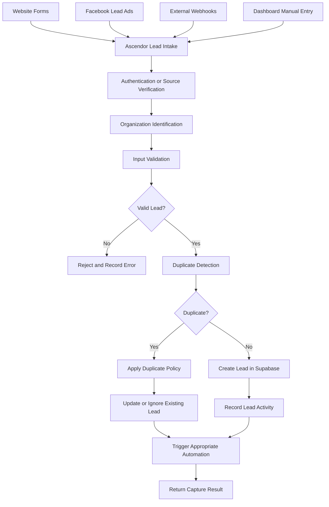

# Ascendor Flagship 01 — Lead Capture Workflow

## 1. Overview

**Project:** Ascendor AI Lead Generation & Revenue Engine

**Component:** Lead Capture

**Purpose:** Define how Ascendor receives, validates, processes, and stores incoming business leads.

Lead Capture is the first operational component of the Ascendor Revenue Engine.

The system must capture leads reliably, prevent unauthorized organization access, preserve data integrity, and support multiple lead sources.

## 2. Lead Capture Objectives

- Receive leads from multiple acquisition channels.
- Validate incoming lead information.
- Associate every lead with the correct organization.
- Prevent unauthorized cross-tenant data access.
- Detect potential duplicate leads.
- Store valid leads in Supabase.
- Trigger downstream automation workflows.
- Provide clear success and failure responses.
- Maintain operational visibility through logs.

## 3. Supported Lead Sources

### Website Forms

Receive inquiries from business websites and landing pages.

### Facebook Lead Ads

Receive lead information through authorized Facebook integrations.

### External Webhooks

Accept lead submissions from authorized external applications.

### API Integrations

Allow authorized applications to submit leads through the Ascendor API.

### Manual Entry

Allow authorized organization members to create leads directly through the Ascendor dashboard.

## 4. Lead Capture Architecture



## 5. Organization Identification

Every incoming lead must be associated with an authorized organization.

### Requirements

- Organization context must be verified.
- Organization IDs supplied by external sources must not be blindly trusted.
- Website forms must use organization-specific configuration.
- External integrations must be associated with an authorized organization.
- Dashboard submissions must derive organization access from authenticated membership.
- Organization isolation must be enforced by backend authorization and Supabase RLS.

## 6. Lead Data Requirements

### Required Fields

- Full name
- At least one valid contact method, such as email or phone

### Optional Fields

- Email
- Phone
- Company name
- Lead source
- Budget
- Estimated revenue
- Intent
- Urgency
- Additional inquiry information

### System-Generated Fields

- Lead ID
- Organization ID
- Lead status
- Qualification status
- Lead score
- Created timestamp
- Updated timestamp

## 7. Input Validation

The system must validate lead information before storing it.

### Validation Rules

- Full name must not be empty.
- At least one contact method must be provided.
- Email must follow a valid email format when provided.
- Phone must follow an acceptable format when provided.
- Numeric fields must contain valid numeric values.
- Lead score must remain within the permitted range.
- Unsupported or malformed payloads must be rejected.
- Input size must be limited.
- External input must be treated as untrusted.

Validation errors must provide understandable feedback without exposing internal system details.

## 8. Duplicate Lead Detection

Ascendor must identify potential duplicate submissions.

### Duplicate Detection Signals

- Normalized email address.
- Normalized phone number.
- Organization ID.
- Existing lead records.

### Duplicate Handling

Duplicate detection must be organization-specific.

Possible outcomes:

- Update an existing lead when the submission represents a legitimate update.
- Preserve the existing record when the submission contains no meaningful changes.
- Record a new activity when an existing lead is updated.
- Create a new lead when the submission represents a distinct opportunity.

Duplicate detection must not incorrectly merge different people or legitimate business opportunities.

## 9. Lead Creation

When a valid lead is accepted:

1. Verify the organization context.
2. Validate the incoming data.
3. Apply duplicate detection.
4. Create or update the lead record.
5. Assign an appropriate initial status.
6. Record the lead activity.
7. Trigger the relevant downstream automation.
8. Return the appropriate result.

### Initial Lead Status

Newly created leads must begin with an appropriate initial status.

Default status:

`NEW`

Qualification status:

`PENDING`

Initial lead score:

`0`

These defaults must be consistent across the database and application logic.

## 10. Lead Capture API

### Endpoint

`POST /api/v1/leads`

### Purpose

Receive and process incoming business leads.

### Example Request

```json
{
  "full_name": "John Smith",
  "email": "john@example.com",
  "phone": "+639171234567",
  "company_name": "Example Company",
  "source": "website",
  "budget": 5000,
  "intent": "high",
  "urgency": "medium",
  "message": "Interested in your services."
}
```

### Processing Requirements

- Authenticate or verify the request according to its source.
- Identify the authorized organization.
- Validate the request body.
- Apply duplicate detection.
- Store the lead securely.
- Trigger downstream automation safely.

### Successful Response

```json
{
  "success": true,
  "message": "Lead captured successfully.",
  "lead_id": "generated-lead-uuid"
}
```

### Validation Error Response

```json
{
  "success": false,
  "message": "Lead information is invalid.",
  "errors": [
    {
      "field": "email",
      "message": "Invalid email format."
    }
  ]
}
```

## 11. Automation Integration

Lead Capture connects to the downstream Ascendor business processes.

### Triggered Events

- Lead created.
- Lead updated.
- Lead captured from a new source.
- Lead capture failed.

### Downstream Processes

- AI Lead Qualification.
- CRM and Lead Scoring.
- Automated Follow-Up.
- Appointment and Sales Handoff.
- Revenue Intelligence.

### Integration Requirements

- Workflow execution must use verified organization context.
- Lead IDs must reference existing records.
- Duplicate workflow execution must be controlled.
- Failed automation must not silently lose captured leads.
- Workflow failures must be recorded for recovery.

## 12. Reliability and Error Handling

The lead capture system must handle failures predictably.

### Requirements

- Validate inputs before database writes.
- Handle database failures.
- Handle external integration failures.
- Prevent duplicate processing where possible.
- Use retry mechanisms for recoverable failures.
- Record relevant errors.
- Avoid silent lead loss.
- Provide clear operational status.

### Reliability Principle

A successfully stored lead must not disappear because a downstream automation workflow fails.

Lead persistence and workflow execution must be handled as separate reliability concerns.

## 13. Security Requirements

- Verify incoming external requests.
- Protect webhook endpoints.
- Apply rate limiting.
- Validate all external inputs.
- Enforce organization-level authorization.
- Prevent cross-tenant data access.
- Protect integration credentials.
- Avoid exposing sensitive information in error messages.
- Log security-relevant events appropriately.

## 14. Acceptance Criteria

Lead Capture is considered complete when:

- Website leads can be received.
- Authorized external integrations can submit leads.
- Dashboard users can create leads.
- Lead information is validated.
- Leads are associated with the correct organization.
- Potential duplicates are detected.
- Valid leads are stored in Supabase.
- Invalid submissions are rejected.
- Lead activities are recorded appropriately.
- Downstream automation can be triggered.
- Failures are logged and recoverable.
- Organization data isolation is enforced.

## 15. Architecture Philosophy

Ascendor must capture every legitimate business opportunity reliably while protecting organization data.

Lead Capture must be simple for business users and dependable for the entire automation platform.

**Reliable lead capture. Secure organization isolation. Zero silent failures.**
