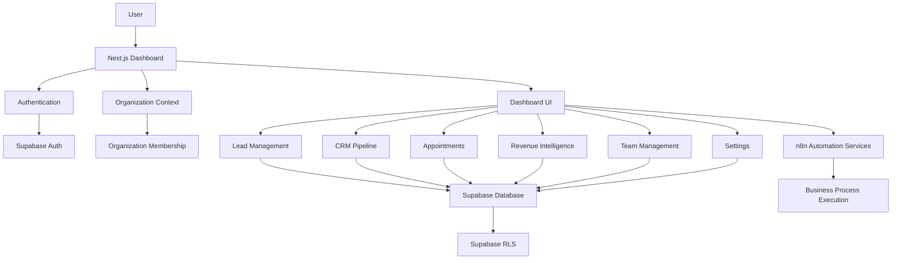

# Ascendor Flagship 01 — Next.js Dashboard Architecture

## 1. Document Overview

**Project:** Ascendor AI Lead Generation & Revenue Engine  
**Module:** Next.js Dashboard  
**Version:** 1.0  
**Status:** Architecture Specification  
**Architecture Standard:** Reliable, Scalable, Premium, Simple & Usable

This document defines the frontend architecture and user experience of Ascendor Flagship 01.

The dashboard is the primary interface through which business owners, administrators, and sales representatives interact with Ascendor.

It provides a unified workspace for managing leads, monitoring sales pipelines, reviewing AI qualification results, managing appointments, and understanding business performance.

The dashboard must hide technical complexity while presenting business-critical information through an intuitive, professional, and consistent interface.

---

## 2. Dashboard Objectives

The primary objective is to provide a premium and usable interface for managing business operations.

The dashboard must:

- Provide secure user authentication.
- Support multiple organizations.
- Support multiple users within organizations.
- Provide organization switching.
- Display business performance.
- Manage leads and customer information.
- Display AI qualification results.
- Manage CRM pipeline stages.
- Manage appointments.
- Display revenue analytics.
- Provide team management.
- Manage integrations and organization settings.
- Support responsive layouts.
- Provide clear loading, success, empty, and error states.
- Enforce organization-level authorization.
- Maintain a consistent premium visual identity.

### Product Philosophy

The dashboard should make a sophisticated automation platform feel simple.

Business owners should not need to understand:

- n8n workflows.
- Database queries.
- AI prompts.
- API integrations.
- Cloud infrastructure.
- Automation execution details.

They should simply understand their leads, opportunities, appointments, and revenue.

---

## 3. Frontend Technology Stack

### Core Technologies

| Technology | Responsibility |
|---|---|
| Next.js | Frontend framework |
| TypeScript | Type safety |
| React | UI component architecture |
| Tailwind CSS | Styling system |
| Supabase | Authentication and database access |
| Supabase SSR | Secure server-side authentication integration |
| React Hook Form | Form management |
| Zod | Input validation |
| Recharts | Analytics visualization |
| Lucide React | Icon system |

Additional libraries may be introduced when they provide measurable value.

### Technology Principle

Ascendor should maintain a focused frontend stack.

Avoid unnecessary dependencies, duplicated state management systems, and excessive UI libraries.

The objective is a maintainable, performant, and consistent product.

---

## 4. Dashboard Architecture

The dashboard must follow a modular frontend architecture.



### Architecture Rules

- Next.js handles the user interface.
- Supabase handles authentication and authorized data access.
- Organization context determines the active workspace.
- Row Level Security protects organization data.
- n8n handles automation execution.
- The frontend must not directly expose privileged automation credentials.
- Sensitive operations must be validated server-side.

---

## 5. Application Structure

Recommended frontend structure:

```text
src/
├── app/
│   ├── (auth)/
│   │   ├── login/
│   │   ├── signup/
│   │   ├── forgot-password/
│   │   └── reset-password/
│   │
│   ├── (dashboard)/
│   │   └── [organizationSlug]/
│   │       ├── layout.tsx
│   │       ├── page.tsx
│   │       ├── leads/
│   │       ├── pipeline/
│   │       ├── appointments/
│   │       ├── analytics/
│   │       ├── team/
│   │       └── settings/
│   │
│   ├── auth/
│   │   └── callback/
│   │
│   ├── api/
│   │
│   ├── layout.tsx
│   └── globals.css
│
├── components/
│   ├── ui/
│   ├── layout/
│   ├── dashboard/
│   ├── leads/
│   ├── pipeline/
│   ├── appointments/
│   ├── analytics/
│   ├── team/
│   └── settings/
│
├── features/
│   ├── authentication/
│   ├── organizations/
│   ├── leads/
│   ├── pipeline/
│   ├── appointments/
│   ├── analytics/
│   └── team/
│
├── lib/
│   ├── supabase/
│   ├── auth/
│   ├── permissions/
│   ├── validation/
│   └── utils/
│
├── hooks/
├── types/
└── config/
```

### Structure Principles

- Organize components by responsibility.
- Separate reusable UI from business features.
- Keep authentication logic centralized.
- Keep organization context consistent.
- Reuse validation schemas.
- Avoid unnecessary duplication.
- Maintain clear boundaries between frontend and automation services.

This is the proposed architecture; implementation details may evolve as the application grows.

---

## 6. Authentication Interface

The dashboard must provide a secure and intuitive authentication experience.

### Authentication Pages

- Login.
- Sign up.
- Forgot password.
- Password reset.
- Email verification.
- Authentication callback.

### Login Experience

The login interface should provide:

- Email input.
- Password input.
- Password visibility control.
- Remember-session behavior where supported.
- Forgot password link.
- Clear validation errors.
- Loading state.
- Successful authentication feedback.

### Authentication Requirements

- Use Supabase Auth.
- Validate credentials securely.
- Protect authenticated routes.
- Maintain session securely.
- Refresh sessions correctly.
- Handle expired sessions.
- Prevent unauthorized access.
- Avoid exposing authentication tokens.
- Provide appropriate logout behavior.

Authentication must be enforced through secure server-side session validation, not merely frontend visibility controls.

---

## 7. Organization Workspace

Ascendor must support multiple organizations and multiple users.

### Organization Context

Each authenticated user may belong to one or more organizations.

The dashboard must identify the active organization before displaying organization-specific business data.

### Organization Switching

Users with multiple organization memberships should be able to switch workspaces.

The organization switcher should display:

- Organization name.
- Organization logo when available.
- Active organization indicator.
- Available organization memberships.

### Organization Context Rules

- Every dashboard request must resolve the active organization.
- Organization membership must be validated.
- Unauthorized organization access must be rejected.
- Organization switching must update dashboard context.
- Previous organization data must not remain visible after switching.
- Data queries must remain organization-scoped.
- Organization permissions must be enforced server-side.

### Workspace Principle

The user should always understand which organization they are currently managing.

---

## 8. Dashboard Layout

The dashboard should use a consistent application shell.

### Primary Layout

```text
┌──────────────────────────────────────────────────────────────┐
│                    Top Navigation                          │
│ Logo | Organization | Search | Notifications | Profile    │
├───────────────┬────────────────────────────────────────────┤
│              │                                            │
│ Sidebar      │              Main Content                  │
│              │                                            │
│ Overview     │              Page Header                   │
│ Leads        │                                            │
│ Pipeline     │              Page Content                  │
│ Appointments │                                            │
│ Analytics    │                                            │
│ Team         │                                            │
│ Settings     │                                            │
│              │                                            │
└──────────────┴────────────────────────────────────────────┘
```

### Layout Components

- Application sidebar.
- Top navigation.
- Organization switcher.
- Page header.
- Main content container.
- Notification interface.
- User profile menu.
- Responsive navigation.

### Navigation Principle

Navigation must remain predictable across every dashboard module.

Users should never feel lost inside the application.

---

## 9. Executive Dashboard

The executive dashboard is the primary business overview.

### Dashboard Objectives

Provide an immediate understanding of:

- Business performance.
- Lead activity.
- Sales pipeline.
- Appointments.
- Revenue opportunities.
- Important follow-up actions.

### Dashboard Sections

#### KPI Cards

Recommended KPI cards:

- Total Leads.
- Qualified Leads.
- Appointments.
- Conversion Rate.
- Pipeline Value.
- Closed Revenue.

Each card should provide:

- Metric name.
- Metric value.
- Reporting period.
- Comparison when meaningful.
- Optional trend visualization.

#### Lead Conversion Funnel

Display:

- Incoming leads.
- Qualified leads.
- Appointments booked.
- Meetings completed.
- Sales opportunities.
- Won customers.

#### Pipeline Overview

Display:

- Opportunities per stage.
- Estimated value per stage.
- Opportunities requiring attention.

#### Upcoming Appointments

Display:

- Appointment time.
- Lead name.
- Sales representative.
- Meeting type.
- Appointment status.

#### Recent Activity

Display:

- New leads.
- Qualification updates.
- Appointment bookings.
- Pipeline changes.
- Important sales activities.

### Dashboard Rules

- Metrics must use consistent definitions.
- Reporting periods must be clear.
- Currency must be organization-specific.
- Empty data must not appear as fabricated metrics.
- Charts must not overwhelm the interface.
- Dashboard widgets must respect organization permissions.

---

## 10. Lead Management Interface

Lead Management is one of the most important operational interfaces.

### Lead List

The lead list should display:

- Lead name.
- Company.
- Email.
- Lead source.
- Lead score.
- Qualification status.
- Pipeline stage.
- Assigned representative.
- Creation date.
- Last activity.

### Lead Filtering

Users should be able to filter by:

- Lead source.
- Qualification status.
- Pipeline stage.
- Lead score.
- Assigned representative.
- Creation date.
- Follow-up status.

### Lead Search

Search should support relevant lead fields such as:

- Name.
- Email.
- Company.

Search must remain organization-scoped.

### Lead Detail Page

The lead detail page should provide:

- Contact information.
- Company information.
- Qualification results.
- Lead score.
- Budget.
- Intent.
- Urgency.
- Pipeline stage.
- Assigned representative.
- Activity history.
- Appointment history.
- Follow-up history.
- AI qualification summary.
- Sales notes.
- Related opportunities.

### Lead Actions

Authorized users may:

- Edit lead information.
- Assign a representative.
- Update qualification information.
- Change pipeline stage.
- Schedule appointments.
- Add notes.
- Trigger permitted follow-up actions.
- Mark leads as converted or lost according to business rules.

### Lead UX Principle

The lead detail page should provide a complete and organized view of a customer's sales journey.

---

## 11. AI Qualification Interface

The AI Qualification interface displays qualification results generated by Ascendor.

### Qualification Information

The interface should display:

- Qualification status.
- Lead score.
- Budget information.
- Customer intent.
- Urgency.
- Customer requirements.
- Qualification summary.
- Recommended next action.
- Qualification timestamp.

### AI Result Presentation

AI-generated information should be visually distinguishable from verified business data.

### AI Safety Requirements

- Display qualification status clearly.
- Identify AI-generated summaries.
- Avoid presenting unsupported AI conclusions as facts.
- Allow authorized users to review results.
- Allow human correction where appropriate.
- Record important qualification changes.
- Avoid exposing AI prompts or sensitive credentials.

### Human Review

Organizations should be able to configure whether certain qualification outcomes require human approval before further action.

---

## 12. CRM Pipeline Interface

The CRM Pipeline interface provides visual management of sales opportunities.

### Pipeline View

Recommended presentation:

- Kanban board.
- Pipeline stage columns.
- Opportunity cards.
- Stage counts.
- Estimated stage values.

### Opportunity Card

Each card may display:

- Lead name.
- Company.
- Lead score.
- Estimated deal value.
- Assigned representative.
- Last activity.
- Next follow-up.

### Pipeline Actions

Authorized users should be able to:

- Move opportunities between stages.
- Assign representatives.
- Update opportunity values.
- View opportunity details.
- Record sales activities.
- Mark opportunities as won or lost.

### Pipeline Rules

- Pipeline stages must belong to the active organization.
- Stage transitions must be validated.
- Opportunity updates must be authorized.
- Changes must be recorded in activity history.
- Won and lost opportunities must follow defined lifecycle rules.
- Pipeline values must use consistent currency.

### Pipeline UX Principle

Sales representatives should be able to understand and update the sales pipeline without unnecessary administrative steps.

---

## 13. Appointment Calendar Interface

The appointment interface should provide scheduling and meeting management.

### Calendar Views

Recommended views:

- Day.
- Week.
- Month.
- Upcoming appointments list.

### Appointment Information

Display:

- Lead name.
- Appointment date.
- Appointment time.
- Time zone.
- Assigned representative.
- Meeting type.
- Appointment status.
- Meeting link or location.

### Appointment Actions

Authorized users may:

- Create appointments.
- Reschedule appointments.
- Cancel appointments.
- Assign representatives.
- View lead context.
- Record meeting outcomes.
- Add meeting notes.
- Initiate permitted follow-up actions.

### Appointment UX Requirements

- Display time zones clearly.
- Prevent unauthorized appointment modification.
- Display scheduling conflicts.
- Provide clear confirmation before cancellation.
- Update appointment views after successful changes.
- Display calendar integration status when relevant.

---

## 14. Revenue Intelligence Interface

The Revenue Intelligence interface provides business performance visibility.

### Analytics Sections

- Executive overview.
- Lead analytics.
- Pipeline analytics.
- Conversion analytics.
- Revenue analytics.
- Lead source analytics.
- Sales representative analytics.
- Appointment analytics.

### Analytics Filters

Users should be able to filter by:

- Reporting period.
- Lead source.
- Pipeline stage.
- Sales representative.
- Opportunity status.

### Analytics Presentation

Recommended visualizations:

- KPI cards.
- Line charts.
- Bar charts.
- Funnel charts.
- Pipeline distribution.
- Revenue trend charts.
- Performance tables.

### Analytics Requirements

- Metrics must be clearly labeled.
- Reporting periods must be visible.
- Charts must be readable.
- Currency formatting must be consistent.
- Missing data must be handled appropriately.
- Analytics must respect organization access controls.

### Revenue UX Principle

The dashboard should help business owners understand what is happening and what deserves attention.

---

## 15. Team Management Interface

The Team Management interface allows authorized organization members to manage users and access.

### Team Overview

Display:

- Organization members.
- Member names.
- Email addresses.
- Roles.
- Membership status.
- Invitation status.

### Team Actions

Authorized users may:

- Invite members.
- Assign roles.
- Remove members.
- Review pending invitations.
- Manage permitted team settings.

### Role Management

Supported organization roles:

- Owner.
- Admin.
- Member.

Sales representative responsibilities may be represented through membership permissions or additional business-level assignments.

### Team Security

- Only authorized users may manage membership.
- Users cannot grant themselves higher privileges.
- Owner permissions must be protected.
- Organization membership must remain tenant-scoped.
- Role changes must be validated server-side.
- Membership changes should be recorded.

---

## 16. Settings Interface

The Settings interface manages organization configuration.

### Settings Sections

#### Organization Settings

- Organization name.
- Organization logo.
- Organization details.
- Default time zone.
- Default currency.

#### Pipeline Settings

- Pipeline stages.
- Stage order.
- Default stage.
- Stage configuration.

#### Scheduling Settings

- Business hours.
- Appointment duration.
- Booking rules.
- Reminder settings.
- Meeting types.

#### Integration Settings

- Calendar integrations.
- Email integrations.
- Lead source integrations.
- Automation connection status.

#### Team Settings

- Organization members.
- Roles.
- Invitations.
- Access configuration.

### Settings Security

- Settings access must be role-based.
- Sensitive configuration must be protected.
- Integration credentials must not be exposed.
- Configuration changes must be validated.
- Important changes should be recorded.

---

## 17. Notification Interface

Ascendor should provide a centralized notification experience.

### Notification Types

- New qualified lead.
- High-priority lead.
- Appointment booked.
- Appointment rescheduled.
- Appointment cancelled.
- Follow-up overdue.
- Opportunity stalled.
- Opportunity won.
- Opportunity lost.
- Automation failure requiring attention.

### Notification Requirements

- Notifications must be organization-scoped.
- Users should receive only relevant notifications.
- Notification preferences should be configurable.
- Duplicate notifications should be minimized.
- Notification status should be recorded.
- Sensitive information should not be unnecessarily exposed.

### Notification UX

The notification interface should provide:

- Unread indicator.
- Notification list.
- Relevant action link.
- Read/unread status.
- Clear notification context.

---

## 18. Design System

Ascendor must maintain a consistent visual design system.

### Design Principles

- Premium.
- Minimal.
- Professional.
- Consistent.
- Accessible.
- Responsive.
- Business-oriented.

### Design Foundation

The design system should define:

- Typography.
- Color palette.
- Spacing.
- Border radius.
- Shadows.
- Layout grid.
- Iconography.
- Component states.
- Responsive breakpoints.

### Typography

Typography should prioritize:

- Readability.
- Clear hierarchy.
- Consistent heading styles.
- Professional appearance.
- Comfortable reading experience.

### Color System

The color system should include:

- Primary brand color.
- Secondary brand color.
- Neutral colors.
- Background colors.
- Text colors.
- Success colors.
- Warning colors.
- Error colors.
- Information colors.

Status colors must remain consistent throughout the dashboard.

### Component System

Reusable components should include:

- Buttons.
- Inputs.
- Selects.
- Dropdowns.
- Dialogs.
- Cards.
- Tables.
- Badges.
- Tooltips.
- Tabs.
- Pagination.
- Charts.
- Navigation items.
- Empty states.
- Loading states.
- Error states.

### Design Principle

The interface should feel like one cohesive product rather than a collection of disconnected pages.

---

## 19. Responsive Design

Ascendor must support desktop, tablet, and mobile interfaces.

### Desktop

Prioritize:

- Full sidebar navigation.
- Multi-column dashboard layouts.
- Data tables.
- Pipeline boards.
- Detailed analytics.

### Tablet

Prioritize:

- Adaptive navigation.
- Reduced column layouts.
- Touch-friendly controls.
- Readable analytics.

### Mobile

Prioritize:

- Compact navigation.
- Mobile-friendly lead lists.
- Simplified appointment management.
- Responsive KPI cards.
- Touch-friendly buttons.
- Clear forms.
- Reduced horizontal scrolling.

### Responsive Requirements

- No unnecessary horizontal overflow.
- Readable text.
- Accessible controls.
- Proper touch target sizes.
- Responsive charts.
- Usable navigation.
- Consistent interaction behavior.

### Mobile Principle

The mobile interface must remain useful for real business operations, not merely display a scaled-down desktop page.

---

## 20. Frontend Data Access Architecture

The dashboard must use secure and consistent data access patterns.

### Data Access Principles

- Use Supabase authentication.
- Validate organization membership.
- Use Row Level Security.
- Avoid unrestricted client queries.
- Validate user inputs.
- Use typed data structures.
- Handle database errors.
- Keep privileged operations server-side.

### Server-Side Operations

Sensitive operations should use:

- Server Components.
- Server Actions where appropriate.
- Route Handlers where appropriate.
- Secure server-side service functions.

### Client-Side Operations

Client-side components may handle:

- Interactive forms.
- Filters.
- Calendar interactions.
- Modal dialogs.
- Charts.
- UI state.
- User interaction.

Client-side controls must never replace server-side authorization.

### Supabase Security Rule

The Supabase service role key must never be exposed to the browser.

---

## 21. State Management

Ascendor should use a simple and predictable state management strategy.

### State Categories

| State | Recommended Handling |
|---|---|
| Authentication session | Supabase Auth |
| Organization context | Server-validated organization membership |
| Database records | Supabase queries |
| Form state | React Hook Form |
| Validation | Zod |
| Local UI state | React state |
| Shared UI state | Context only when necessary |
| Server-derived data | Server Components or controlled data-fetching patterns |

### State Management Principle

Avoid unnecessary global state.

The application should maintain a clear distinction between:

- Server data.
- User input.
- Temporary UI state.
- Authentication state.
- Organization context.

---

## 22. Reliability and Error Handling

The dashboard must provide predictable behavior.

### Reliability Requirements

- Validate form inputs.
- Handle database errors.
- Handle expired sessions.
- Handle unauthorized requests.
- Handle failed integrations.
- Prevent duplicate submissions.
- Provide clear error messages.
- Display loading states.
- Display empty states.
- Confirm destructive actions.
- Preserve user input when practical.
- Refresh data after successful changes.

### Interface States

Every major dashboard feature should support:

- Loading.
- Success.
- Empty.
- Error.
- Unauthorized.
- Disabled.
- Pending.

### Error Message Principle

Error messages should explain:

- What happened.
- Whether the action succeeded.
- What the user can do next.

Technical stack traces and sensitive internal details must not be displayed to ordinary users.

---

## 23. Security and Authorization

The dashboard must follow Ascendor's multi-tenant security architecture.

### Security Requirements

- Protect authenticated routes.
- Validate organization membership.
- Enforce role-based permissions.
- Apply Supabase Row Level Security.
- Validate server-side inputs.
- Protect sensitive credentials.
- Prevent unauthorized organization switching.
- Restrict privileged operations.
- Secure integration settings.
- Prevent unauthorized data exports.
- Protect user sessions.
- Avoid exposing internal automation credentials.

### Authorization Principle

The frontend may hide actions that users cannot perform.

However, actual authorization must always be enforced server-side.

---

## 24. Performance and Scalability

The dashboard must support growing organizations and increasing data volumes.

### Performance Requirements

- Optimize page loading.
- Avoid unnecessary database queries.
- Use pagination for large datasets.
- Use appropriate database indexes.
- Avoid loading entire lead tables.
- Optimize chart data.
- Minimize unnecessary client-side JavaScript.
- Use reusable components.
- Avoid unnecessary rerenders.
- Cache only where authorization and data freshness permit.

### Scalability Strategy

The initial dashboard should use Supabase and Next.js without unnecessary infrastructure complexity.

As usage increases, Ascendor may introduce:

- Optimized database queries.
- Materialized analytics views.
- Background data aggregation.
- Advanced caching.
- Dedicated analytics services.
- Additional application infrastructure.

Scaling decisions should be based on actual usage and performance requirements.

---

## 25. Accessibility

Ascendor should provide an accessible user interface.

### Accessibility Requirements

- Keyboard navigation.
- Clear focus states.
- Accessible form labels.
- Appropriate color contrast.
- Screen-reader-friendly controls.
- Accessible dialog behavior.
- Meaningful error messages.
- Accessible charts and data tables.
- Consistent interaction patterns.

Accessibility must be considered during component design rather than added only at the end.

---

## 26. Dashboard Acceptance Criteria

The dashboard architecture is considered ready for MVP implementation when:

- Authentication pages are defined.
- Protected dashboard routes are defined.
- Organization context is supported.
- Organization switching is defined.
- Sidebar navigation is defined.
- Executive dashboard is defined.
- Lead management interface is defined.
- Lead detail interface is defined.
- AI qualification interface is defined.
- CRM pipeline interface is defined.
- Appointment interface is defined.
- Revenue Intelligence interface is defined.
- Team management interface is defined.
- Settings interface is defined.
- Notification interface is defined.
- Reusable design system is defined.
- Responsive behavior is defined.
- Loading, success, empty, and error states are defined.
- Supabase data access is secured.
- Tenant authorization is enforced.
- Sensitive credentials remain server-side.
- Dashboard metrics use consistent definitions.
- The interface follows the four architecture quality standards.

---

## 27. Future Enhancements

Potential future capabilities:

- Advanced AI sales assistant.
- AI-powered dashboard recommendations.
- Custom dashboard widgets.
- Drag-and-drop dashboard customization.
- Advanced reporting builder.
- White-label organization branding.
- Custom organization domains.
- Advanced permissions.
- Sales team collaboration.
- Mobile application.
- Client-specific dashboard customization.
- Unified Ascendor multi-flagship dashboard.

These capabilities should be introduced when they provide measurable business value.

---

## 28. Architectural Principle

The Next.js Dashboard must provide a unified, intuitive, and premium interface for Ascendor Flagship 01.

It must connect the six business processes into one understandable workspace.

The architecture must remain:

- **Reliable** — secure data access and predictable interface behavior.
- **Scalable** — modular components and multi-tenant support.
- **Premium** — polished design and consistent user experience.
- **Simple & Usable** — intuitive navigation and minimal operational complexity.

### Final Product Philosophy

**Powerful underneath. Simple on the surface. Premium in every interaction.**

Ascendor should not feel like a complicated automation system.

It should feel like a premium business platform that helps organizations manage leads, sales opportunities, appointments, and revenue with confidence.
