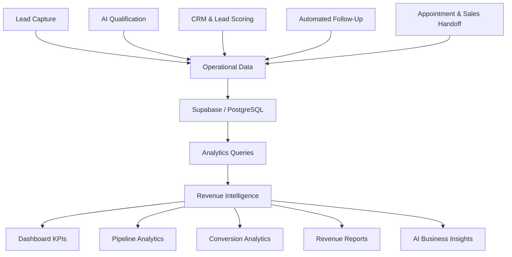
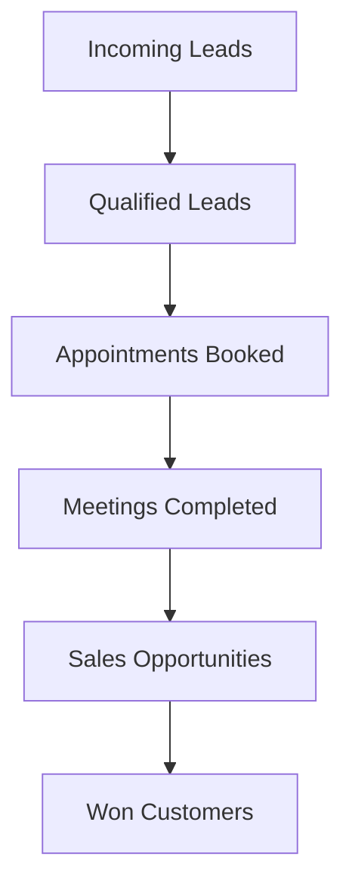
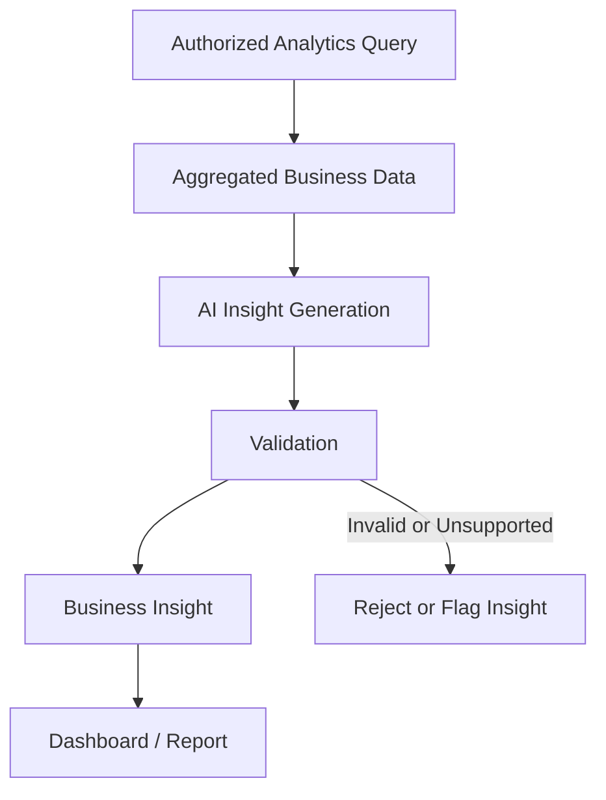

# Ascendor Flagship 01 — Revenue Intelligence

## 1. Document Overview

**Project:** Ascendor AI Lead Generation & Revenue Engine  
**Module:** Revenue Intelligence  
**Version:** 1.0  
**Status:** Architecture Specification  
**Architecture Standard:** Reliable, Scalable, Premium, Simple & Usable

This document defines the Revenue Intelligence architecture of Ascendor Flagship 01.

Revenue Intelligence transforms operational data from lead capture, AI qualification, CRM, automated follow-up, and appointment scheduling into actionable business insights.

The module enables organizations to understand their sales pipeline, evaluate lead quality, measure conversion performance, monitor revenue opportunities, and make better business decisions.

Revenue Intelligence is not merely a reporting feature.

It is the business visibility layer that helps organizations understand how effectively their sales and automation processes generate opportunities and revenue.

---

## 2. Business Objective

The primary objective of Revenue Intelligence is to provide organizations with clear, reliable, and actionable visibility into their sales performance.

The system must:

- Provide organization-level revenue visibility.
- Display sales pipeline performance.
- Track lead-to-customer conversion.
- Monitor appointment conversion.
- Measure lead source effectiveness.
- Track sales representative performance.
- Monitor follow-up effectiveness.
- Identify pipeline bottlenecks.
- Generate automated business reports.
- Provide actionable sales insights.
- Support data-driven decision-making.
- Maintain secure organization-specific analytics.

### Business Outcome

Ascendor should help business owners answer:

- How many leads are entering our business?
- Which leads are qualified?
- Which leads are becoming customers?
- Which lead sources generate the best opportunities?
- Where are opportunities getting stuck?
- How effectively are sales representatives converting opportunities?
- How much potential revenue exists in our pipeline?
- How much revenue has actually been generated?
- Which business processes need improvement?

The system must convert complex operational data into information that business owners can understand and act upon.

---

## 3. Architectural Position

Revenue Intelligence operates as the analytics and business visibility layer of Ascendor Flagship 01.

It consumes data from the six core business processes.

### Six Core Business Processes

| Process | Intelligence Contribution |
|---|---|
| 01 — Lead Capture | Lead volume, sources, acquisition activity |
| 02 — AI Lead Qualification | Qualification rates, lead quality |
| 03 — CRM & Lead Scoring | Pipeline distribution, lead prioritization |
| 04 — Automated Follow-Up | Follow-up effectiveness, engagement |
| 05 — Appointment & Sales Handoff | Appointment conversion, sales activity |
| 06 — Revenue Intelligence | Reporting, analytics, business insights |

### System Components

| Component | Responsibility |
|---|---|
| Next.js Dashboard | Analytics visualization and business reporting |
| Supabase | Operational data and analytics queries |
| n8n | Scheduled reports and automated insight workflows |
| PostgreSQL | Aggregations, indexes, and analytics queries |
| AI Services | Optional insight generation and business summaries |

### Architectural Flow

---

## 4. Revenue Intelligence Data Sources

Revenue Intelligence must use data generated by the existing operational modules.

### Primary Data Sources

- Organizations
- Organization memberships
- Leads
- Pipeline stages
- Lead activities
- Appointments
- Automation logs
- Sales assignments
- Meeting outcomes
- Follow-up activities
- Revenue records or approved revenue fields

### Data Integrity Principle

Analytics must be derived from reliable operational records.

The system must not treat:

- AI-generated revenue estimates as actual revenue.
- Lead scores as guaranteed sales outcomes.
- Appointment bookings as completed meetings.
- Qualified leads as converted customers.
- Pipeline value as realized revenue.

Every metric must have a clearly defined business meaning.

---

## 5. Dashboard KPI Architecture

The Revenue Intelligence dashboard should present a concise set of business-critical KPIs.

### Executive KPI Overview

Recommended primary KPIs:

| KPI | Description |
|---|---|
| Total Leads | Leads created within the selected reporting period |
| Qualified Leads | Leads meeting the organization's qualification criteria |
| Qualification Rate | Qualified leads divided by eligible leads |
| Appointments Booked | Appointments successfully scheduled |
| Meetings Completed | Appointments marked completed |
| Conversion Rate | Converted leads divided by eligible leads |
| Open Opportunities | Opportunities currently active in the pipeline |
| Pipeline Value | Estimated value of active sales opportunities |
| Closed Revenue | Revenue recorded from successfully closed deals |
| Lost Opportunities | Opportunities marked lost |

### Dashboard Design Principle

The dashboard should prioritize business outcomes rather than technical execution details.

Business owners should immediately understand:

- Current performance.
- Performance trends.
- Revenue opportunities.
- Conversion bottlenecks.
- Actions requiring attention.

Technical workflow logs and infrastructure metrics should remain in operational monitoring interfaces rather than overwhelming the primary business dashboard.

---

## 6. Lead Analytics

Lead Analytics provides visibility into acquisition activity and lead quality.

### Lead Volume Metrics

The system should track:

- Total leads received.
- New leads.
- Leads by source.
- Leads by organization.
- Leads by reporting period.
- Leads by qualification status.
- Leads by pipeline stage.

### Lead Quality Metrics

The system should track:

- Qualified lead count.
- Unqualified lead count.
- Qualification rate.
- Average lead score.
- High-priority lead count.
- Leads requiring review.
- Leads missing important information.

### Lead Qualification Rate

Recommended definition:

Qualification Rate = Qualified Leads / Eligible Leads × 100

The organization must define which leads are eligible for qualification reporting.

For example, leads still awaiting qualification may be excluded from the denominator.

The dashboard must clearly document the calculation to avoid misleading results.

---

## 7. Pipeline Intelligence

Pipeline Intelligence provides visibility into the movement of opportunities through the sales process.

### Pipeline Metrics

The system should track:

- Leads per pipeline stage.
- Opportunities per pipeline stage.
- Pipeline value per stage.
- Stage conversion rates.
- Average time spent in each stage.
- Stalled opportunities.
- Lost opportunities.
- Won opportunities.
- Pipeline movement over time.

### Pipeline Visualization

The dashboard should provide:

- Pipeline summary.
- Stage distribution.
- Opportunity counts.
- Estimated opportunity value.
- Conversion between stages.
- Opportunities requiring attention.

### Pipeline Value

Pipeline Value represents the estimated monetary value of active opportunities.

It must not be confused with realized revenue.

The system should define which pipeline stages are considered active and whether estimated values are required.

### Pipeline Rules

- Pipeline stages must belong to the correct organization.
- Pipeline metrics must respect organization-specific stage configuration.
- Lost and won opportunities must not be incorrectly counted as active pipeline.
- Pipeline value must use consistent currency handling.
- Missing opportunity values must not silently become zero-valued sales.

---

## 8. Conversion Analytics

Conversion Analytics measures how effectively leads progress toward customers.

### Lead Conversion

Recommended definition:

Lead Conversion Rate = Converted Leads / Eligible Leads × 100

The organization must define the conversion event.

For example, a lead may be considered converted when its opportunity reaches a Won stage or when a customer conversion record is created.

### Appointment Conversion

The system should measure:

- Qualified leads booked into appointments.
- Appointments successfully completed.
- Completed meetings converted into opportunities.
- Opportunities converted into customers.

### Conversion Funnel

### Funnel Analytics

The dashboard should display:

- Number of records at each stage.
- Conversion rate between stages.
- Drop-off rate.
- Time required to progress.
- Major conversion bottlenecks.

### Conversion Integrity

Conversion reporting must use consistent definitions.

A booked appointment is not automatically a completed meeting.

A completed meeting is not automatically a customer.

A customer is not automatically a recorded revenue transaction.

---

## 9. Revenue Analytics

Revenue Analytics provides visibility into actual business revenue and estimated sales opportunities.

### Revenue Categories

| Category | Description |
|---|---|
| Pipeline Value | Estimated value of active opportunities |
| Forecast Revenue | Estimated future revenue based on defined forecasting rules |
| Won Deal Value | Value of successfully closed opportunities |
| Actual Revenue | Revenue recorded according to the organization's revenue policy |
| Lost Deal Value | Value of opportunities marked lost |

### Revenue Reporting Requirements

The system should support:

- Revenue by reporting period.
- Revenue by pipeline stage.
- Revenue by lead source.
- Revenue by sales representative.
- Revenue by organization.
- Revenue trend analysis.
- Won and lost opportunity reporting.
- Revenue forecasting.

### Revenue Integrity

Revenue Intelligence must distinguish between:

- Estimated deal value.
- Forecast revenue.
- Won opportunity value.
- Actual recognized or recorded revenue.

The initial MVP may track won deal value without implementing formal accounting revenue recognition.

Formal accounting and financial reporting are outside the scope of this module unless explicitly introduced in a future version.

### Currency Management

Revenue records must support currency identification.

Recommended fields:

- amount
- currency_code

The system must not combine different currencies into a single total without a defined conversion policy.

Currency conversion should use a documented exchange-rate source and conversion timestamp if introduced.

---

## 10. Lead Source Intelligence

Lead Source Intelligence identifies which acquisition channels produce the strongest business opportunities.

### Supported Sources

Potential lead sources include:

- Website forms.
- Facebook lead forms.
- Landing pages.
- Manual entry.
- Referral.
- Email inquiries.
- Advertising campaigns.
- External integrations.
- Other organization-defined sources.

### Lead Source Metrics

The system should track:

- Leads per source.
- Qualified leads per source.
- Qualification rate per source.
- Appointments per source.
- Converted customers per source.
- Revenue per source.
- Average lead score per source.

### Source Performance Analysis

The dashboard should help organizations identify:

- High-volume sources.
- High-quality sources.
- Sources with poor qualification rates.
- Sources producing the most appointments.
- Sources generating the most revenue.

### Attribution Rules

Lead source attribution must be defined consistently.

The initial MVP should use the original lead source as the primary attribution field.

Future versions may support:

- First-touch attribution.
- Last-touch attribution.
- Multi-touch attribution.
- Campaign attribution.
- Paid advertising attribution.

Attribution models must not be mixed without clear labels.

---

## 11. Sales Representative Intelligence

Sales Representative Intelligence provides visibility into individual and team sales performance.

### Sales Performance Metrics

The system should support:

- Leads assigned.
- Qualified leads assigned.
- Appointments booked.
- Meetings completed.
- Opportunities created.
- Won opportunities.
- Lost opportunities.
- Conversion rate.
- Pipeline value.
- Won deal value.
- Follow-up completion.
- Average response time.

### Sales Representative Comparison

Authorized organization users may compare:

- Performance by representative.
- Conversion rates.
- Appointment completion rates.
- Pipeline contribution.
- Opportunity progression.
- Revenue contribution.

### Performance Integrity

Sales metrics must account for:

- Lead ownership.
- Appointment assignment.
- Opportunity ownership.
- Reassignment history.
- Reporting period.
- Organization-specific permissions.

The system should avoid attributing the entire lifetime value of an opportunity to every representative who previously handled it.

Future versions may introduce more advanced contribution attribution.

---

## 12. Follow-Up Intelligence

Follow-Up Intelligence measures the effectiveness of automated and manual follow-up activities.

### Follow-Up Metrics

The system should track:

- Follow-up tasks created.
- Follow-up messages sent.
- Follow-up delivery failures.
- Follow-up completion.
- Leads contacted.
- Leads requiring follow-up.
- Follow-up response rates where measurable.
- Opportunities progressing after follow-up.

### Follow-Up Performance

The dashboard should identify:

- Leads with overdue follow-ups.
- Leads with no recent activity.
- Failed follow-up executions.
- Opportunities requiring sales attention.
- Follow-up sequences associated with conversion.

### Measurement Limitations

Email delivery does not guarantee that a customer read or responded to a message.

Open rates may be inaccurate because of email privacy features and tracking limitations.

Revenue Intelligence should prioritize reliable business events over unreliable engagement signals.

---

## 13. Opportunity Intelligence

Opportunity Intelligence identifies sales opportunities that require attention.

### Opportunity Signals

Potential signals include:

- High lead score.
- High customer intent.
- Urgent customer requirement.
- High estimated deal value.
- Upcoming appointment.
- Overdue follow-up.
- Long period without activity.
- Opportunity stalled in a pipeline stage.
- Recently completed meeting.
- Customer requesting a proposal.

### Opportunity Prioritization

The system may classify opportunities as:

- High Priority.
- Medium Priority.
- Low Priority.
- Requires Attention.

Prioritization should be based on defined business rules.

AI may assist in generating recommendations, but important business actions must remain controllable by authorized users.

### Opportunity Alerts

The system may notify authorized users when:

- A high-value opportunity becomes qualified.
- A qualified lead books an appointment.
- A sales opportunity becomes stalled.
- A follow-up becomes overdue.
- A deal is won.
- A deal is lost.
- An important automation fails.

Notifications must be configurable to avoid excessive noise.

---

## 14. AI-Powered Business Insights

Ascendor may use AI to summarize business performance and identify patterns.

### AI Insight Capabilities

Potential capabilities include:

- Revenue performance summaries.
- Pipeline bottleneck analysis.
- Lead source performance summaries.
- Sales activity summaries.
- Conversion trend explanations.
- Opportunity prioritization recommendations.
- Follow-up improvement recommendations.
- Weekly business performance summaries.

### AI Insight Example

An AI-generated insight might explain:

- Which pipeline stage has the largest number of stalled opportunities.
- Which lead source produces the highest qualification rate.
- Which opportunities require immediate follow-up.
- Which sales representatives have upcoming meetings requiring preparation.

### AI Safety Requirements

AI insights must:

- Be grounded in actual analytics data.
- Clearly distinguish facts from recommendations.
- Avoid inventing revenue or business metrics.
- Respect organization boundaries.
- Avoid exposing another organization's information.
- Avoid making unauthorized CRM changes.
- Support human review where required.

### AI Insight Architecture

AI should explain business data, not replace the underlying analytics engine.

---

## 15. Automated Business Reports

Ascendor should support automated reporting for business owners and sales teams.

### Report Types

- Daily sales activity report.
- Weekly pipeline report.
- Weekly lead performance report.
- Monthly revenue report.
- Sales representative performance report.
- Appointment performance report.
- Lead source performance report.
- Automation performance report.

### Report Delivery

Initial delivery channel:

- Email.

Future channels:

- Dashboard notifications.
- Slack.
- Microsoft Teams.
- Other supported communication platforms.

### Report Configuration

Organizations should be able to configure:

- Report type.
- Reporting period.
- Recipients.
- Delivery schedule.
- Report format.
- Included metrics.

### Report Reliability

The system must:

- Generate reports from validated data.
- Respect organization permissions.
- Prevent duplicate report delivery.
- Record report generation status.
- Record delivery failures.
- Retry transient failures.
- Avoid exposing sensitive data to unauthorized recipients.

---

## 16. Analytics Data Architecture

Revenue Intelligence should initially use Supabase and PostgreSQL for operational analytics.

### Initial Architecture

- Supabase PostgreSQL as the primary data source.
- Organization-scoped queries.
- Database indexes for common filters.
- Aggregation queries for dashboard metrics.
- Controlled access through authenticated application queries.
- n8n for scheduled report generation.

### Analytics Query Principles

Analytics queries must:

- Filter by organization.
- Respect reporting periods.
- Use consistent metric definitions.
- Avoid unnecessary full-table scans.
- Use appropriate indexes.
- Avoid exposing raw sensitive information unnecessarily.
- Return only the information required by the dashboard.

### Performance Optimization

As data volume increases, Ascendor may introduce:

- Materialized views.
- Pre-aggregated analytics tables.
- Scheduled aggregation workflows.
- Database query optimization.
- Dedicated analytics storage.
- Data warehouse integration.

These optimizations should be introduced based on actual performance requirements.

---

## 17. Recommended Analytics Data Structures

Revenue Intelligence should build upon the existing operational schema.

### Existing Data Sources

| Table | Analytics Purpose |
|---|---|
| organizations | Organization-level reporting |
| organization_members | User and representative context |
| leads | Lead volume, qualification, conversion |
| pipeline_stages | Pipeline distribution |
| lead_activities | Sales activity and progression |
| appointments | Appointment and meeting analytics |
| automation_logs | Automation reliability and execution |
| Future opportunities table | Opportunity value and sales lifecycle |
| Future revenue records | Actual revenue tracking |

### Recommended Future Data Structures

Additional tables may be introduced through future schema migrations.

#### Opportunities

Purpose:

Represent sales opportunities independently from lead records.

Potential fields:

- id
- organization_id
- lead_id
- name
- owner_id
- pipeline_stage_id
- estimated_value
- currency_code
- probability
- status
- expected_close_date
- closed_at
- created_at
- updated_at

#### Revenue Records

Purpose:

Represent recorded revenue events separately from opportunity estimates.

Potential fields:

- id
- organization_id
- opportunity_id
- lead_id
- amount
- currency_code
- revenue_type
- recorded_at
- created_by
- created_at

#### Analytics Snapshots

Purpose:

Store historical metric snapshots when necessary.

Potential fields:

- id
- organization_id
- metric_name
- metric_value
- reporting_period
- currency_code
- generated_at

These structures are architectural recommendations and are not considered implemented until their database migrations are created and tested.

---

## 18. Multi-Tenant Analytics

Revenue Intelligence must support multiple organizations without data leakage.

### Tenant Isolation Requirements

- All analytics must be organization-scoped.
- Organization membership must be validated.
- Supabase Row Level Security must protect underlying data.
- Analytics queries must not bypass tenant authorization.
- AI insight generation must receive only authorized organization data.
- Reports must be delivered only to authorized recipients.
- Organization-specific configurations must remain isolated.
- Cross-organization comparisons must not be available to ordinary organization users.

### Administrative Analytics

Platform-level analytics may be introduced for Ascendor internal administration.

Such analytics must use a separate authorization model and must not expose client information to unauthorized personnel.

---

## 19. Reliability and Error Handling

Revenue Intelligence must produce trustworthy business information.

### Reliability Requirements

- Validate analytics inputs.
- Use consistent metric definitions.
- Prevent duplicate report generation.
- Handle missing data appropriately.
- Handle failed scheduled workflows.
- Log analytics execution.
- Monitor reporting failures.
- Protect against unauthorized queries.
- Preserve reporting history where required.
- Avoid misleading zero values.
- Distinguish unavailable metrics from actual zero results.

### Failure Scenarios

| Failure | Expected Behavior |
|---|---|
| Analytics query fails | Display an appropriate error state |
| No data exists | Display an empty state, not fabricated metrics |
| Report generation fails | Record failure and initiate recovery |
| AI insight unsupported | Reject or flag the insight |
| Unauthorized organization access | Deny access |
| Currency mismatch | Prevent invalid aggregation |
| Historical data incomplete | Display limitations where relevant |
| Scheduled workflow fails | Log execution and retry according to policy |

### Data Accuracy Principle

A metric must never appear accurate merely because it is displayed in a polished dashboard.

Accuracy and business meaning take priority over visual presentation.

---

## 20. Security and Privacy

Revenue Intelligence must follow Ascendor's security architecture.

### Security Requirements

- Enforce organization-level authorization.
- Apply Supabase Row Level Security.
- Validate reporting permissions.
- Protect sensitive revenue information.
- Restrict access to sales performance data.
- Protect report recipients.
- Keep privileged credentials server-side.
- Prevent unauthorized analytics exports.
- Avoid exposing raw customer information unnecessarily.
- Secure AI data processing.
- Log sensitive administrative actions.

### Role-Based Analytics Access

| Role | Analytics Capabilities |
|---|---|
| Owner | Full organization analytics |
| Admin | Organization analytics and reporting |
| Member | Authorized operational and analytics information |
| Sales Representative | Assigned leads and permitted sales performance metrics |

Exact permissions must be enforced server-side.

---

## 21. Dashboard Experience

The Revenue Intelligence dashboard must follow Ascendor's Premium & Usable design principles.

### Executive Dashboard

The executive dashboard should include:

- KPI summary.
- Revenue overview.
- Pipeline overview.
- Lead conversion funnel.
- Lead source performance.
- Appointment performance.
- Sales performance.
- Opportunities requiring attention.
- Business trends.

### Analytics Navigation

Recommended dashboard sections:

1. Overview.
2. Leads.
3. Pipeline.
4. Revenue.
5. Appointments.
6. Sales Performance.
7. Reports.
8. Insights.

### UX Requirements

- Clear metric labels.
- Consistent number formatting.
- Readable charts.
- Useful date filters.
- Organization-specific currency.
- Clear reporting periods.
- Accessible visual design.
- Helpful empty states.
- Clear loading states.
- Clear error states.
- Minimal unnecessary complexity.

### Dashboard Principle

Business owners should be able to understand business performance without understanding database queries, automation workflows, or AI infrastructure.

---

## 22. Revenue Intelligence Acceptance Criteria

Revenue Intelligence is considered ready for MVP implementation when:

- Organization-level analytics are available.
- Lead volume metrics are accurate.
- Qualification metrics are defined.
- Pipeline metrics are available.
- Appointment metrics are available.
- Conversion metrics use consistent definitions.
- Lead source analytics are available.
- Sales representative metrics respect permissions.
- Pipeline value is distinguished from actual revenue.
- Currency handling is defined.
- Dashboard reporting periods are supported.
- Analytics queries enforce tenant isolation.
- Empty states are handled correctly.
- Scheduled reports can be generated.
- Report delivery failures are logged.
- AI insights are grounded in actual data.
- Revenue Intelligence data is available through the dashboard.
- Metrics can be validated against underlying records.

---

## 23. Future Enhancements

Potential future capabilities:

- Predictive revenue forecasting.
- AI-powered pipeline recommendations.
- Advanced sales attribution.
- Campaign performance analytics.
- Customer lifetime value analysis.
- Sales velocity analysis.
- Revenue forecasting models.
- Advanced opportunity scoring.
- Industry benchmarking.
- Cross-flagship business intelligence.
- Unified Ascendor executive dashboard.
- Data warehouse integration.
- Advanced financial analytics.

These capabilities should be introduced when they provide measurable business value and can be implemented reliably.

---

## 24. Architectural Principle

Revenue Intelligence must transform Ascendor's operational data into trustworthy business insights.

It should help organizations understand their leads, opportunities, appointments, sales performance, and revenue without requiring technical expertise.

The module must remain:

- **Reliable** — analytics are accurate, consistent, and trustworthy.
- **Scalable** — analytics support multiple organizations and growing data volumes.
- **Premium** — dashboards and reports are polished and professional.
- **Simple & Usable** — business insights are understandable and actionable.

### Final Product Philosophy

**Powerful underneath. Simple on the surface. Premium in every interaction.**

Ascendor should not merely collect business data.

It should help businesses understand their performance, identify opportunities, and make better revenue decisions.
